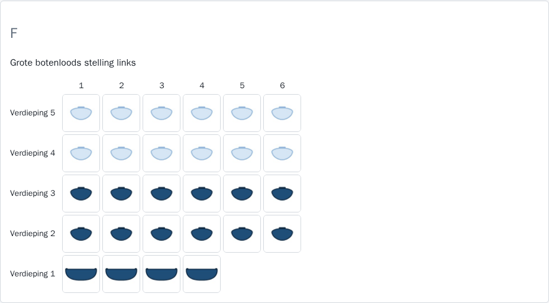
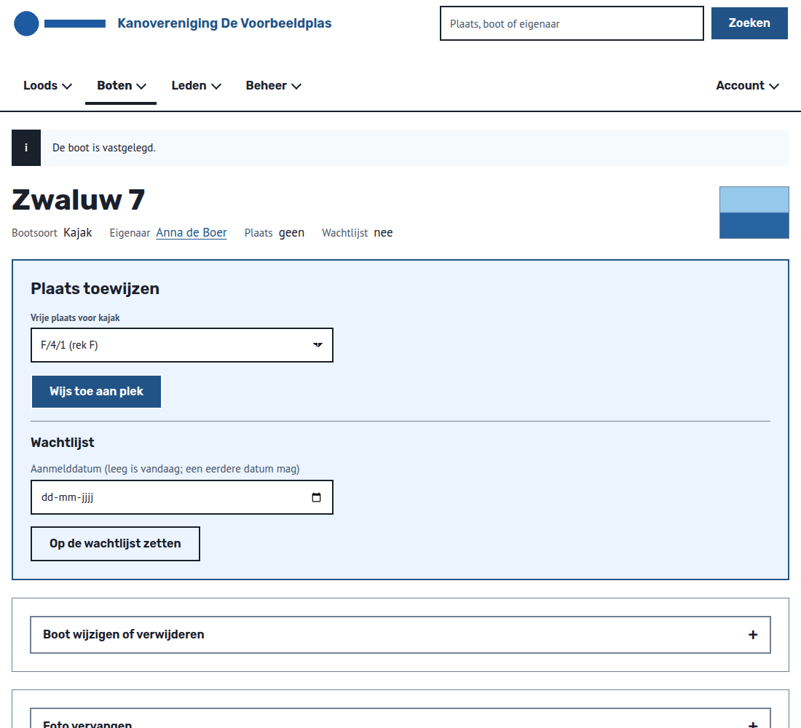
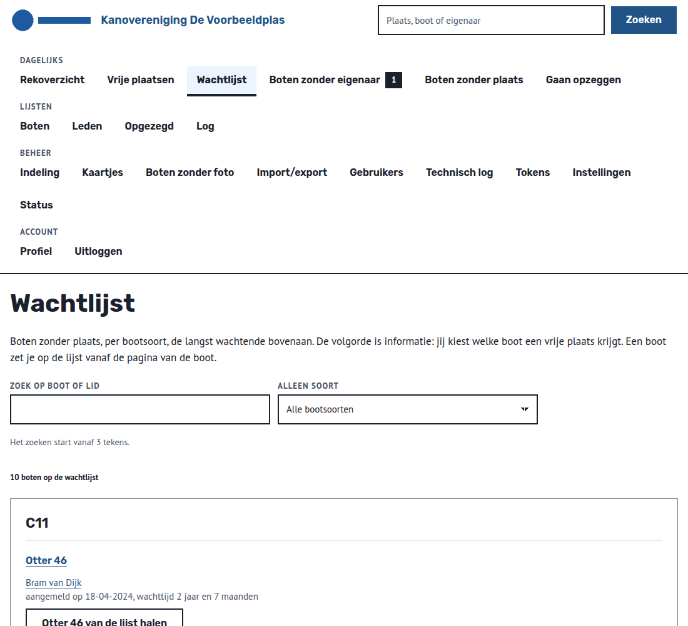
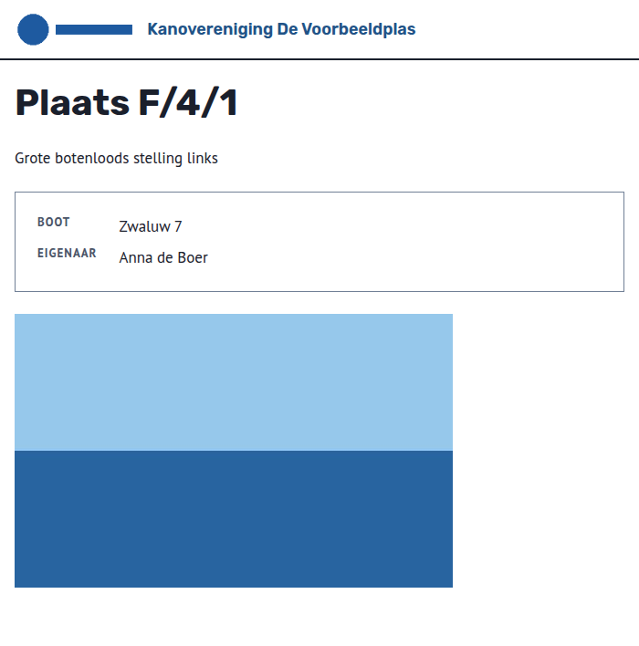

# botenloodsbeheer

Een webapplicatie waarmee een kanovereniging bijhoudt welke boot op welke plaats in de botenloods ligt, van wie die boot is, welke plaatsen vrij zijn en wie op de wachtlijst staat. Het vervangt de spreadsheet waarin dat eerst stond. De applicatie werkt op een groot scherm en op een telefoon.

## Wat de applicatie doet

**De loods in beeld.** Het rekoverzicht toont per rek en per verdieping welke plaats bezet is en welke vrij. De indeling met rekken, verdiepingen en plaatsen leg je in de applicatie vast. Per plaats stel je in voor welke bootsoorten hij geschikt is, en of het een clubplaats is. Een plaats is te hernoemen zonder dat toewijzingen of QR-codes breken.

**Boten en eigenaren.** Elke boot heeft een naam, een bootsoort, een eigenaar en zo nodig een foto. Vanaf de pagina van een boot wijs je een plaats toe, verplaats je de boot of zet je hem op de wachtlijst. De applicatie weigert een plaats die niet bij de bootsoort past, en een ledenboot op een clubplaats. Zoeken op plaats, boot of eigenaar kan vanuit de kop van elk scherm.

**Wachtlijst per bootsoort.** Een boot zonder plaats komt op de wachtlijst van zijn bootsoort, met aanmelddatum en wachttijd. De beheerder kiest zelf wie een vrije plaats krijgt; de applicatie wijst niet automatisch toe.

**Leden uit de ledenadministratie.** De leden komen uit e-boekhouden, via een aparte integratiecontainer die alleen via de API werkt. Een andere vereniging kan die container vervangen door een koppeling met een eigen ledenbron. De applicatie bewaart alleen lidnummer, naam en lidmaatschapsdata, geen adres, telefoon of e-mail. Overzichten tonen welke leden gaan opzeggen en welke opgezegde leden nog een plaats hebben. Gegevens van oud-leden worden 5 jaar na de opzegdatum opgeschoond.

**Kaartjes en een openbare pagina.** Per plaats print je een kaartje met een QR-code. De QR-code opent een openbare pagina met de plaats, de boot, de naam van de eigenaar en de foto. Wie langs het rek loopt, ziet zo zonder in te loggen van wie een boot is.

**Export, import en log.** De indeling gaat naar Excel, en indeling en bezetting gaan als CSV de applicatie uit en in. Elke wijziging staat in het mutatielog, en onder elk overzicht staan de bootmutaties die erbij horen.

**Inloggen en API.** Beheerders loggen in met een passkey of met een wachtwoord en een authenticator-app. Er is een API (`/api/v1`, met OpenAPI-specificatie) met persoonlijke tokens en robottokens, rechten per token en een IP-whitelist.

## Documentatie

- Projectregels: `docs/PROJECT-OVERLAY.md`. Architectuur: `docs/architecture/architectuur.md`.

- Voor beheerders van de botenloods: [handleiding](documentatie/gebruikers/handleiding.md).
- Voor systeembeheerders (installatie achter Traefik, voorbeelden, integratiecontainer, bijwerken): [beheerdocumentatie](documentatie/beheer/installatie.md).

## Lokaal starten

1. `cp .env.example .env`, `chmod 600 .env` en de geheimen invullen (uitleg staat in het bestand). De standaarden `DOMEIN=localhost` en een lege `TRAEFIK_CERTRESOLVER` passen bij lokaal.
2. `mkdir -p secrets && install -m 600 /dev/null secrets/api_token`: zonder dat bestand start compose niet.
3. `docker compose -f docker-compose.yml -f compose.dev.yml up --build -d`. Lokaal start een eigen Traefik mee; de netwerken maakt compose zelf.
4. Een token voor de integratiecontainer maken en in `secrets/api_token` zetten volgens `documentatie/beheer/integratiecontainer.md`. Binnen een minuut importeert de container de synthetische leden met de stub. De import neemt ook oud-leden op van wie de opzegdatum hooguit 5 jaar geleden is (#298). De twee oud-leden van de fixture met een opzegdatum in 2019 vallen buiten die termijn; die slaat de import over.
5. `docker compose -f docker-compose.yml -f compose.dev.yml exec worker flask seed` voor een synthetische loods (alleen buiten productie). Seed maakt geen leden: alleen de import via de API schrijft leden.
6. Een login aanmaken, zie hieronder.

De applicatie draait op http://localhost:8080. De API (`/api/v1`) is alleen bereikbaar via het entrypoint `intern` van Traefik op poort 8081, vanaf het netwerk `koppeling` (ADR-012, ADR-013).

### Een login aanmaken

De eerste beheerder maak je op de commandoregel; het commando maakt altijd een beheerder. Elke volgende gebruiker, beheerder of kijker, nodig je uit via `/gebruikers` in de applicatie.

1. `docker compose -f docker-compose.yml -f compose.dev.yml exec web flask beheerder uitnodigen <gebruikersnaam>`. De gebruikersnaam is 2 tot 50 tekens: a-z, cijfers, punt, streepje en onderstreping.
2. Het commando toont een link (`<BASIS_URL>/uitnodiging/<code>`). Die werkt één keer en is 24 uur geldig.
3. Open de link en kies een passkey, of een wachtwoord van 12 tot 128 tekens met een authenticator-app (QR-code scannen en een eerste code invullen).
4. Log in op http://localhost:8080/inloggen.

Een passkey hangt aan de host uit `BASIS_URL` (of `WEBAUTHN_RP_ID`). Open de link dus op dezelfde host, `localhost` en niet `127.0.0.1`. Is de link verlopen of gebruikt, draai het commando dan opnieuw met een andere gebruikersnaam, of herstel de gebruiker via `/gebruikers`.

## API-token

- Maken: `docker compose exec web flask token robot <naam> --recht leden:importeren --recht bootaantallen:lezen`. Het token verschijnt één keer. Zonder `--whitelist` geldt `KOPPELNET`, zonder `--dagen` 365 dagen (hooguit 1095).
- Intrekken: `docker compose exec web flask token intrekken <naam>`. Vervangen is een nieuw token maken en het oude intrekken.
- Controleren: `GET http://traefik:8081/api/v1/ik` met `Authorization: Bearer <token>`, vanaf het netwerk `koppeling`. Het contract staat in `app/api/openapi.yaml`.
- Uitzetten: `API_INGESCHAKELD=false` in `.env` en `docker compose up -d api`.

## Bijwerken

Een update met een nieuwe databaserol (zoals `botenloods_api` in slice 5): zet het wachtwoord in `.env` (`DB_API_WACHTWOORD`) en draai vóór `up` eerst `docker compose up -d db` en `docker compose exec db sh /docker-entrypoint-initdb.d/rollen.sh`. Traefik volgt de containers zelf; een herstart van de proxy is niet nodig.

## Tests

- Unit en integratie: `docker compose -f docker-compose.yml -f compose.dev.yml run --rm test`
- E2E (stack moet draaien): `tests/e2e/draai.sh`, één test met `tests/e2e/draai.sh -k <naam>`. De hele suite draait per bestand, met 40 seconden pauze voor de rate limit op inloggen.

## Productie

Zie [installatie achter een gedeelde Traefik](documentatie/beheer/installatie.md). Het logo van de vereniging upload je als beheerder op Instellingen (JPEG, PNG of WebP); zonder logo toont de kopbalk alleen de naam.

## Licentie en bijdragen

botenloodsbeheer valt onder de [EUPL-1.2](LICENSE). De Nederlandse versie van die licentie is even geldig als de Engelse in `LICENSE` en staat op [joinup.ec.europa.eu](https://joinup.ec.europa.eu/collection/eupl/eupl-text-eupl-12). Bijdragen zijn welkom, zie [CONTRIBUTING.md](CONTRIBUTING.md) en de [gedragscode](CODE_OF_CONDUCT.md). Een beveiligingslek meld je volgens [SECURITY.md](SECURITY.md).
