# Handleiding voor beheerders van de botenloods

Met botenloodsbeheer houd je bij welke boot op welke plaats in de loods ligt en van wie die is. Deze handleiding beschrijft per taak wat je kunt doen en hoe. Ze geldt voor een loods van 11 rekken, 229 plaatsen, ongeveer 210 leden en 180 boten, met 3 beheerders die dezelfde rechten hebben. Er is geen aparte systeembeheerder in de applicatie.

Alle schermen werken in een gewone browser, ook op een telefoon. Schermen over boten en plaatsen tonen onderaan de bootmutaties die erbij horen. Op een telefoon zit het menu achter de knop **Menu** in de kopbalk; op een groter scherm staat het open. Het heeft vier groepen: Dagelijks, Lijsten, Beheer en Account. De pagina waar je bent, is gemarkeerd. De voorbeelden en afbeeldingen gebruiken verzonnen gegevens.

## Inloggen

Je logt in met een passkey (telefoon, vingerafdruk of beveiligingssleutel) of met een wachtwoord plus een code uit een authenticator-app. Een passkey is het eenvoudigst en niet te phishen, daarom staat hij bovenaan.

1. Open `/inloggen`.
2. Kies **Inloggen met passkey** en volg de vraag van je apparaat. Of klap **Met wachtwoord en code** uit, vul je gebruikersnaam en wachtwoord in en kies **Verder**.
3. Bij een wachtwoord vraagt de applicatie daarna de code van zes cijfers uit je authenticator-app.

Na het inloggen sta je op het rekoverzicht. Een mislukte poging met je wachtwoord laat het blok **Met wachtwoord en code** open staan, zodat je het direct opnieuw kunt proberen.

Na vijf mislukte pogingen kun je 15 minuten niet met je wachtwoord inloggen. Met een passkey lukt het wel. De applicatie zegt niet of de gebruikersnaam of het wachtwoord fout was. Een sessie duurt 12 uur. Met **Uitloggen** onderaan het menu (groep Beheer) sluit je hem eerder af.

Een paar handelingen vragen een inlog van hooguit 10 minuten oud: een beheerder uitnodigen, herstellen, blokkeren, deblokkeren of verwijderen, inlogmethodes wijzigen en de instellingen opslaan. Is je inlog ouder, dan vraagt de applicatie je opnieuw in te loggen.

## Beheerders

Het scherm `/beheerders` toont alle accounts met hun status en inlogmethodes. De eerste beheerder maakt wie de installatie beheert (zie de beheerdocumentatie). Daarna nodigen jullie elkaar uit.

### Een beheerder uitnodigen

1. Vul onder **Beheerder uitnodigen** een gebruikersnaam in (2 tot 50 tekens: a-z, cijfers, punt, streepje en onderstreping) en kies **Uitnodigen**.
2. Geef de link die verschijnt aan de nieuwe beheerder. De link werkt één keer en is 24 uur geldig. Hij staat alleen op dit scherm, als tekst en als QR-code. De nieuwe beheerder kan de QR-code met de telefoon scannen in plaats van de link over te typen. Bij **Toegang herstellen** verschijnt dezelfde combinatie.
3. De nieuwe beheerder opent de link en kiest een passkey, of klapt **Wachtwoord en authenticator-app** uit voor een wachtwoord van 12 tot 128 tekens met de QR-code of sleutel voor de authenticator-app en een eerste code. De link zelf staat in een kader; selecteer hem met één tik.

### Een collega blokkeren, herstellen of verwijderen

Achter elk ander account staan drie knoppen. Je eigen account kun je hier niet wijzigen, zodat er altijd een actieve beheerder blijft.

| Knop | Gevolg |
|---|---|
| Blokkeren | De beheerder kan niet meer inloggen. **Deblokkeren** maakt dat ongedaan. |
| Toegang herstellen | Oude inlogmethodes en sessies vervallen. Je krijgt een nieuwe link van 24 uur voor de collega, bijvoorbeeld na een verloren telefoon. |
| Verwijderen | Het account verdwijnt, met de persoonlijke tokens van die beheerder. Het log blijft. |

### Je eigen inlogmethodes

Op `/profiel` staan je inlogmethodes met een knop **Intrekken** per methode. Daaronder voeg je een passkey toe (het blok heet **Passkey toevoegen**, en **Nog een passkey** als je er al een hebt) of, als je er nog geen hebt, een wachtwoord met authenticator-app. Intrekken beëindigt al je sessies. Je houdt altijd minstens één methode.

## Rekken en plaatsen

De loods is ingedeeld in rekken. Een rek heeft een korte naam, een omschrijving en vakken op 1 tot en met 5 verdiepingen, met per verdieping 1 tot en met 12 vakken. Elk vak dat aan staat is een plaats. De aanduiding van een plaats volgt uit rek, verdieping en vak: `A/1/1` is rek A, verdieping 1, vak 1. Een verdieping heeft geen gaten: de vakken zijn altijd 1 tot en met n. Een verdieping met alleen vak 1 en 3 weigert de applicatie, met een melding die de verdieping en het ontbrekende vak noemt.

De pagina `/indeling` toont elk rek met zijn omschrijving en plaatsen. Per plaats staan de aanduiding, de status (vrij, bezet of clubplaats), de boot, de eigenaar en de bootsoorten waarvoor de plaats geschikt is. Een clubplaats is alleen voor boten van de vereniging. Kies een aanduiding om de plaats te openen. Exporteren en importeren doe je op de pagina Import/export, die in het menu onder Beheer staat.

- **Rek aanmaken:** vul bovenaan een naam in (1 tot 10 tekens, zonder `/`, uniek zonder verschil in hoofdletters) en eventueel een omschrijving (hooguit 60 tekens). Vink in het raster de vakken aan die bestaan. Het raster staat zoals het rek in de loods: verdieping 1 onderaan. Elk vakje heet "Verdieping 2, vak 3" voor schermlezers. Kies eventueel per verdieping een bootsoort: elke plaats op die verdieping krijgt die soort als geschikte bootsoort. Een verdieping zonder keuze geeft haar plaatsen geen bootsoort. Kies **Rek aanmaken**.
- **Naam en omschrijving wijzigen:** open **Rek wijzigen of verwijderen**, pas ze aan en kies **Rek opslaan**. Een nieuwe naam verandert de aanduiding van alle plaatsen in het rek. De QR-codes en de toewijzingen blijven gelijk.
- **Vakken aan- of uitzetten:** open **Rek wijzigen of verwijderen**, verander het raster en kies **Indeling opslaan**. Een nieuw vak is een nieuwe plaats, met de bootsoort die je bij Nieuw rek voor die verdieping koos (geen keuze betekent geen bootsoort). Bestaande plaatsen veranderen niet. Een vak dat uit gaat, verdwijnt met zijn plaats. Ligt er een boot op, dan weigert de applicatie en verandert er niets; geef de plaats eerst vrij. Zet je een vak uit dat niet het laatste van zijn verdieping is, dan weigert de applicatie ook, omdat er dan een gat ontstaat. De andere vakken houden hun nummer, boot en QR-code.
- **Rek verwijderen:** kies **Rek ... verwijderen**. Dat lukt alleen als er geen boten meer op liggen.
- **Plaats wijzigen:** open de plaats via de aanduiding. Onder **Plaats wijzigen** pas je bootsoorten en clubstatus aan. De aanduiding zelf wijzigt alleen met de naam van het rek. Een nieuwe plaats heeft de bootsoort van haar verdieping als je die bij Nieuw rek koos; anders vink je er minstens één aan voordat je een boot toewijst. Een plaats weghalen doe je in het raster: zet het vak uit (zie Vakken aan- of uitzetten). Een wijziging die niet past bij de boot die er ligt, weigert de applicatie.

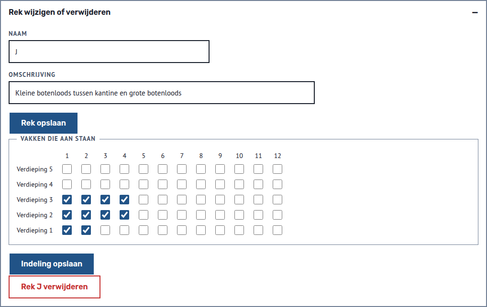

### Rekoverzicht

De pagina `/rekoverzicht` (menu **Rekoverzicht**, groep Dagelijks) toont elk rek zoals het in de loods staat: een rij per verdieping tot en met de hoogste verdieping met een plaats (verdieping 1 onderaan; een lege verdieping daaronder blijft staan), een kolom per vak tot en met het hoogste vak van dat rek, met een plaatje per plaats. Je ziet in één blik waar nog plek is. Kies een plaatje om de plaats te openen. Een rek met veel vakken schuift op een telefoon opzij; de verdiepingen blijven in beeld.

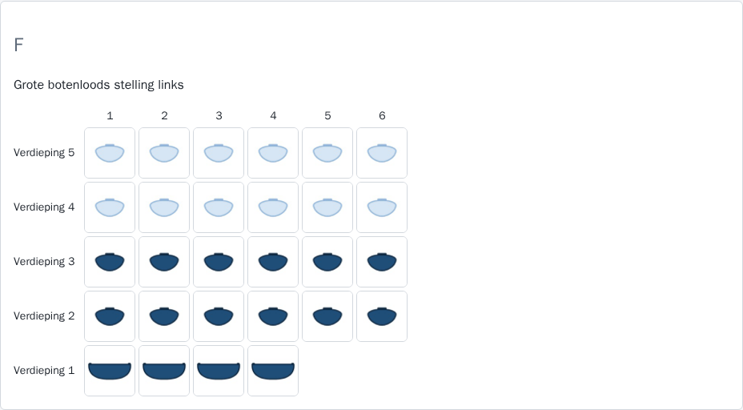

- **Gevulde romp:** de plaats is bezet, met het plaatje van de bootsoort van de boot die er ligt.
- **Romp met alleen een omtrek:** de plaats is vrij, met het plaatje van de eerste bootsoort waarvoor de plaats geschikt is. Is de plaats voor meer soorten geschikt, dan noemt de alternatieve tekst ze allemaal.
- **Gestippelde rand:** een clubplaats zonder boot. Die is niet vrij voor leden. Een clubplaats met een clubboot toont een gevulde romp.
- **Alleen een naam:** een bootsoort zonder plaatje, bijvoorbeeld een soort die je zelf toevoegt, toont de naam als tekst, in een gevulde cel bij bezet en een omrande cel bij vrij. De C11 gebruikt het plaatje van de Canadese kano.
- **Leeg vak:** een plaats zonder bootsoort heeft geen plaatje.

De kleur is niet de enige aanwijzing: elk vak heeft een tekst voor schermlezers, bijvoorbeeld "Plaats A/2/3, Surfski, vrij".

Welke bootsoorten er zijn, stel je in op `/instellingen` (zie Naam, logo en bootsoorten). Een nieuwe installatie begint met kajak, Canadese kano, surfski, C11 en supboard.

## Zoeken vanuit de kop

In de kop van elk scherm staat een zoekveld. Typ een deel van een plaatscode (zoals `B/2`), een bootnaam, de naam van een eigenaar of een lidnummer en kies **Zoeken**. Je zoekt in boten, in leden zonder boot en in plaatsen zonder boot, ook van oud-leden. Hoofdletters en accenten tellen niet mee, en meer woorden zoeken als één tekst. De zoektekst telt minstens 2 tekens (spaties ervoor en erachter tellen niet mee) en hooguit 100.

Is er precies één treffer, dan opent die meteen: de boot, het lid of de plaats. Een lidnummer van een lid met één boot opent de boot. Zijn er meer treffers, dan staat er een lijst op `/zoeken` met eerst de boten, dan de leden zonder boot en dan de vrije plaatsen en clubplaatsen. Een boot toont zijn eigenaar met lidnummer, en de tag oud-lid als de eigenaar is opgezegd. Bij meer dan 50 treffers staan de eerste 50 in de lijst; zoek dan preciezer. Zonder treffers staat er "Geen treffers voor" met de zoektekst. De zoektekst komt niet in de logs.

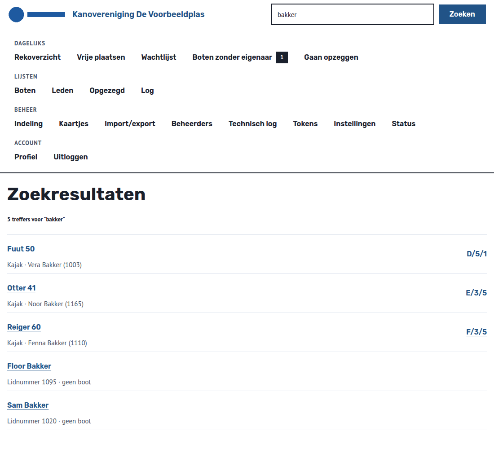

## Boten

Op `/boten` staan alle boten met bootsoort, eigenaar en plaats, met het aantal boten erboven. Zoek met **Zoek op boot of lid** (hoofdletters en accenten tellen niet mee: `jose` vindt ook `José`, en `josé` ook `Jose`) en beperk de lijst met **Alleen soort**; kies daarna **Toon boten**. Zonder zoektekst en zonder soort staan alle boten in de lijst. Een boot heeft een naam, een bootsoort en een eigenaar: een actief lid, de vereniging zelf (clubboot) of nog niemand (eigenaar onbekend, zie Boten zonder eigenaar hieronder). Het blok **Nieuwe boot** staat bovenaan, onder de kop, als knop.

1. Open **Nieuwe boot**. Vul de naam in, kies de bootsoort en de eigenaar. De keuze begint op **eigenaar onbekend**; laat die staan als de eigenaar nog niet bekend is. Een oud-lid staat niet in de lijst.
2. Voeg eventueel een foto toe (JPEG, PNG of WebP, hooguit 10 MB). Is het bestand groter, dan zegt de applicatie dat en wordt de boot niet vastgelegd.
3. Kies **Boot vastleggen**. Je ziet daarna de pagina van de boot. Weigert de applicatie de boot, dan staat het blok **Nieuwe boot** weer open met de melding erboven; vul de velden dan opnieuw in.

Een nieuwe boot heeft nog geen plaats. Bovenaan de pagina van de boot staan de bootsoort, de eigenaar (een link naar het lid; bij een clubboot staat er geen link, bij een onbekende eigenaar staat er alleen "onbekend"), de plaats en, bij een boot zonder plaats, of de boot op de wachtlijst staat. Is er een foto, dan staat die klein rechts. Daaronder staat één blok met de taak die nu past. Heeft de boot een plaats, dan zegt het blok dat je vrijgeven op de plaats doet, met een link naar de plaats; verplaatsen kan vanaf de boot zelf (zie **Boot verplaatsen** hieronder). Heeft de boot geen plaats, dan staan er **Plaats toewijzen** en **Wachtlijst**. Is de eigenaar oud-lid, dan is de taak **Boot verwijderen**. Bij een boot met een plaats staat daaronder het blok **Boot verplaatsen**. De blokken **Boot verplaatsen**, **Boot wijzigen of verwijderen**, **Foto vervangen** en **Log** zijn dicht; open ze met een klik. Onder **Foto vervangen** kies je een andere foto (hooguit 10 MB). Is die groter, is het geen geldige afbeelding of kies je geen bestand, dan staat het blok open met de melding erboven. Een vorige foto blijft dan staan. Bij een boot van een oud-lid heet het eerste blok **Boot wijzigen**, omdat de knop om te verwijderen dan in het taakblok staat. Een boot met een plaats verwijderen weigert de applicatie: geef de plaats eerst vrij. Verwijderen vraagt niet om een bevestiging.

**Boot wijzigen:** open de boot, open het blok **Boot wijzigen of verwijderen** en pas onder **Boot wijzigen** de naam, de bootsoort of de eigenaar aan (een actief lid of de vereniging) en kies **Boot opslaan**. In die lijst staat bij elke boot ook de keuze **eigenaar onbekend**, bijvoorbeeld als de boot is verkocht of verkeerd is geïmporteerd; de boot staat dan op **Boten zonder eigenaar**. Staat de boot op de wachtlijst en krijgt hij een andere eigenaar, dan gaat hij van de lijst. Een onbekende eigenaar hoort net als een lid op een gewone plaats: een clubboot op een clubplaats kan pas onbekend worden als je de plaats eerst hebt vrijgegeven. Een oud-lid kan geen nieuwe eigenaar worden; een boot die al van een oud-lid is, kan wel zo blijven. Heeft de boot een plaats, dan weigert de applicatie een bootsoort die niet bij de plaats past en een wissel tussen een boot van een lid en een clubboot, en zegt ze waarom. Geef de plaats dan eerst vrij. Elke wijziging komt als "boot gewijzigd" in het log onder de boot, onder het oude en het nieuwe lid en in het log van de bootmutaties. Naam, bootsoort en eigenaar staan er met de oude en de nieuwe waarde. De eigenaar staat er als lidverwijzing (zoals `lid:7`), als `vereniging` of als `onbekend`, zonder naam. Wie opslaat zonder iets te veranderen, geeft geen logregel.

**Boot verplaatsen:** open een boot met een plaats en open het blok **Boot verplaatsen**. Kies bij **Verplaats naar een vrije plaats voor** de bootsoort een plaats en kies **Verplaats**. De keuzelijst begint op "Kies een vrije plaats" en toont dezelfde vrije plaatsen als **Plaats toewijzen**; voor een clubboot staan ze onder **Clubplaatsen** en **Gewone plaatsen**. De boot ligt daarna op de nieuwe plaats en de oude plaats is vrij. De wachtlijst verandert niet. Is de gekozen plaats intussen bezet, geschikt voor een andere bootsoort of een clubplaats voor de boot van een lid, dan weigert de applicatie met de reden en met "De boot blijft op" de oude plaats; het blok staat dan open. Is er geen vrije plaats voor de bootsoort, dan staat er "Er is geen vrije plaats voor" de bootsoort en is er geen knop. Bij een boot van een oud-lid ontbreekt het blok: geef zo'n boot vrij op de plaats. Het log krijgt één regel, "boot verplaatst", met de oude en de nieuwe plaats; die staat onder de boot, onder beide plaatsen en in het log van de bootmutaties.

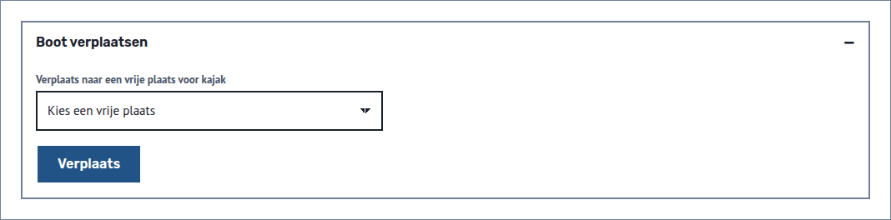

## Boten zonder eigenaar

Op `/boten/zonder-eigenaar` staan de boten waarvan de eigenaar onbekend is, met bootsoort en plaats. Zo'n boot ontstaat door een bezettingsimport met een lege eigenaar, of doordat je bij **Nieuwe boot** de eigenaar open laat. In het menu staat het aantal naast **Boten zonder eigenaar**, onder Dagelijks; bij nul staat er geen aantal. Kies per boot bij **Eigenaar van** een lid of de vereniging en kies **Eigenaar opslaan** met de bootnaam erachter. Een weigering, bijvoorbeeld de vereniging als eigenaar van een boot op de wachtlijst, geldt alleen die boot. Zijn er geen boten meer, dan staat er "Alle boten hebben een eigenaar." Een boot op de wachtlijst houdt zijn plek als hij een eigenaar krijgt.

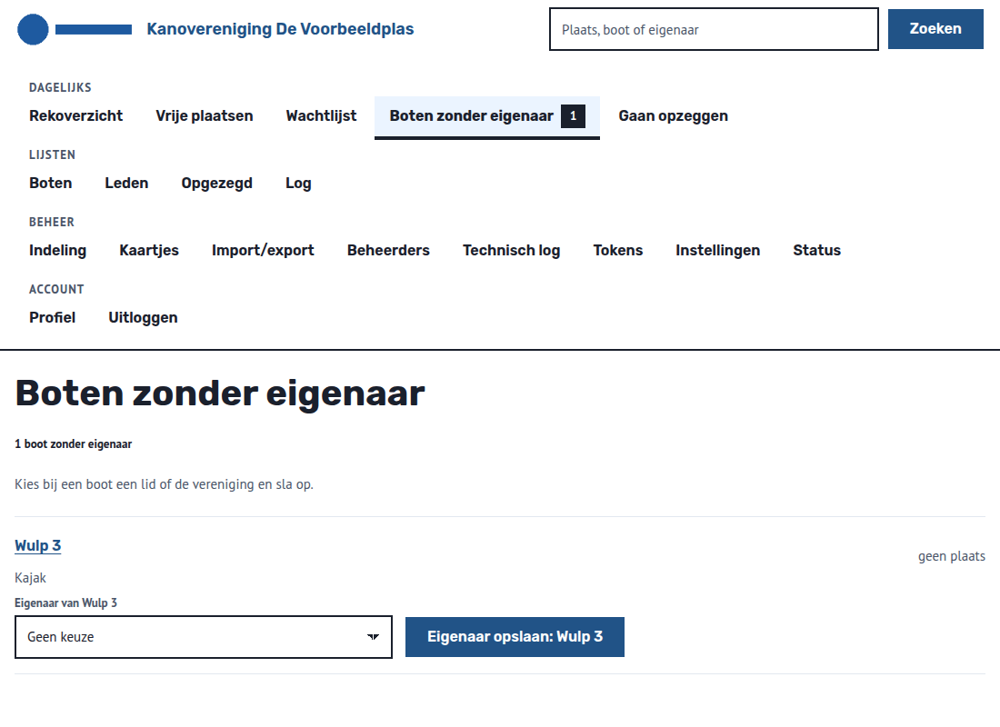

## De wachtlijst

Een boot van een lid of met een onbekende eigenaar, zonder plaats, kan op de wachtlijst van zijn bootsoort. Op `/wachtlijst` staat per bootsoort een eigen lijst, met per boot het lid (of "eigenaar onbekend"), de aanmelddatum en de wachttijd, en het aantal boten op de wachtlijst erboven. De langst wachtende staat bovenaan. Zoek met **Zoek op boot of lid** (hoofdletters en accenten tellen niet mee) of kies bij **Alleen soort** één bootsoort en kies **Toon wachtlijst**. Die volgorde is informatie: jij kiest welke boot een vrije plaats krijgt.

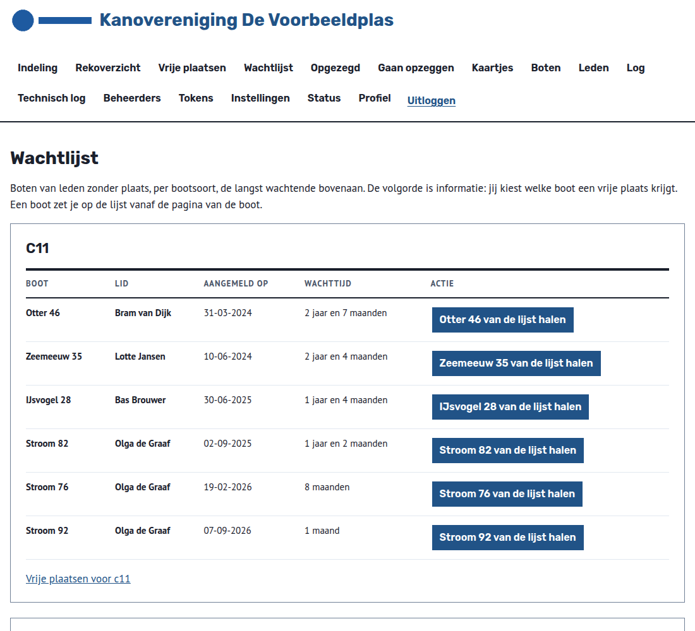

**Een boot op de wachtlijst zetten:** open de boot en kies onder **Wachtlijst** de knop **Op de wachtlijst zetten**. Laat je de aanmelddatum leeg, dan geldt vandaag. Een eerdere datum mag, zodat wie al op een oude lijst stond zijn wachttijd houdt. Een datum in de toekomst weigert de applicatie. De aanmelddatum is daarna niet te wijzigen. Wil je een andere datum, haal de boot dan van de lijst en zet hem er opnieuw op.

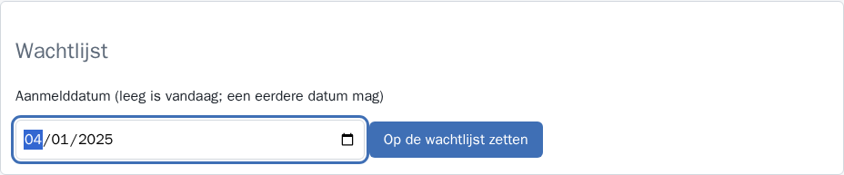

De applicatie weigert een clubboot, een boot van een oud-lid, een boot met een plaats en een boot die al op de lijst staat. Een boot op de wachtlijst kan geen clubboot worden; haal hem eerst van de lijst. Krijgt een boot een andere bootsoort, dan staat hij op de lijst van die soort, met dezelfde aanmelddatum. Een verwijderde boot gaat van de lijst.

**Van de lijst halen:** kies op `/wachtlijst` of op de pagina van de boot de knop om de boot van de lijst te halen. Drie gevallen gaan vanzelf:

- een boot die een plaats krijgt, gaat van de lijst;
- krijgt de boot een andere eigenaar (een ander lid), dan gaat hij van de lijst. De applicatie meldt dat en het log noemt de reden `andere eigenaar`. Zet de boot er daarna zo nodig opnieuw op. Zet je de eigenaar op **eigenaar onbekend**, dan gaat de boot ook van de lijst, met de melding "De eigenaar is nu onbekend en de boot is van de wachtlijst gehaald." Het log noemt ook dan de reden `andere eigenaar`;
- wordt de eigenaar oud-lid, dan haalt de eerstvolgende import van leden de boot van de lijst. Het log noemt dan het robottoken van de import als uitvoerder. Tot die import zegt de taak op de pagina van de boot: "De eigenaar is oud-lid. De boot krijgt geen plaats. Bij de volgende ledenimport gaat de boot van de wachtlijst." Een knop om de boot met de hand van de lijst te halen is er dan niet.

Op de pagina van een lid staat een boot op de wachtlijst met de regel **Wachtlijst: Sinds** en de aanmelddatum; een boot die niet op de lijst staat, heeft die regel niet.

## Een plaats toewijzen of vrijgeven

De applicatie wijst nooit zelf een plaats toe. Jij kiest boot en plaats.

**Toewijzen:** open een vrije plaats (via `/indeling` of `/vrij`), kies onder **Boot zonder plaats** de boot en kies **Plaats toewijzen**. Bovenaan de keuzelijst staan, bij een gewone plaats, de boten op de wachtlijst van een bootsoort die op de plaats past, de langst wachtende eerst. Daaronder staan de andere boten zonder plaats. De applicatie weigert in deze gevallen en zegt waarom:

- de plaats is bezet, of de boot heeft al een plaats;
- de plaats is niet geschikt voor de bootsoort;
- een boot van een lid of met een onbekende eigenaar op een clubplaats (een clubplaats is alleen voor clubboten; een clubboot mag ook op een gewone plaats);
- de eigenaar is oud-lid.

**Vanaf de boot:** een boot zonder plaats, op de wachtlijst of niet, kan ook vanaf zijn eigen pagina een plaats krijgen. Kies onder **Plaats toewijzen** een vrije plaats en kies **Wijs toe aan plek**. De lijst toont alleen vrije plaatsen voor de bootsoort, in de volgorde van de loods; voor een clubboot staan de vrije clubplaatsen eerst, onder **Clubplaatsen**, en daarna de vrije gewone plaatsen, onder **Gewone plaatsen**. Een boot op de wachtlijst gaat daarna van de wachtlijst af. Is er geen vrije plaats, of is de eigenaar oud-lid, dan zegt de pagina dat.

**Vrijgeven:** open de bezette plaats en kies **Plaats ... vrijgeven**. De boot blijft bestaan, zonder plaats. De plaats blijft vrij tot jij een boot kiest, ook als er een wachtlijst is. Wie twee collega's tegelijk dezelfde plaats laat vrijgeven, krijgt één wijziging in het log.

Na het toewijzen toont de plaats de boot, de eigenaar met lidnummer, en de link naar de openbare pagina. In het blok **Eigenaar** is de naam een link naar het lid; bij een oud-lid staat "(oud-lid)" achter de link. Bij een clubboot of een onbekende eigenaar staat er geen link. De openbare pagina heeft geen link naar het lid. Het lidnummer is alleen voor beheerders. Adres, telefoon en e-mail haalt de applicatie niet op uit de ledenadministratie.

## Overzichten

In het menu staan drie overzichten. Ze zijn alleen om te lezen; je werkt vanuit de plaats zelf. Opgezegd en Gaan opzeggen hebben een zoekveld met een eigen knop, en tonen het aantal erboven.

| Menu | Adres | Wat je ziet |
|---|---|---|
| Vrije plaatsen | `/vrij` | Vrije plaatsen voor boten van leden, clubplaatsen niet, met het aantal erboven. Kies bij **Geschikt voor** een bootsoort en kies **Toon vrije plaatsen**. |
| Opgezegd | `/opgezegd` | Boten van oud-leden die nog een plaats hebben, de oudste opzegging bovenaan. Zoek op boot of oud-lid en kies **Toon plaatsen**; hoofdletters en accenten tellen niet mee. |
| Gaan opzeggen | `/opzeggend` | Boten met een plaats van leden met een opzegdatum in de toekomst, de vroegste bovenaan. Zoek op boot of lid en kies **Toon boten**; hoofdletters en accenten tellen niet mee. |

Een lid verhuist van **Gaan opzeggen** naar **Opgezegd** zodra de opzegdatum is bereikt. Open de plaats met de link en geef haar vrij.

## Export naar Excel

Op `/import-export` staat onder **Indeling als Excel** de link **Indeling exporteren naar Excel**. Je krijgt het bestand `indeling.xlsx` met een rij per plaats. De kolommen zijn Rek, Code, Status, Bootsoort, Bootnaam, Eigenaar en Lidnummer. Bij een vrije plaats staat in de kolom Bootsoort waarvoor de plaats geschikt is, tussen haakjes. Adres, telefoon, e-mail en foto zitten er bewust niet in.

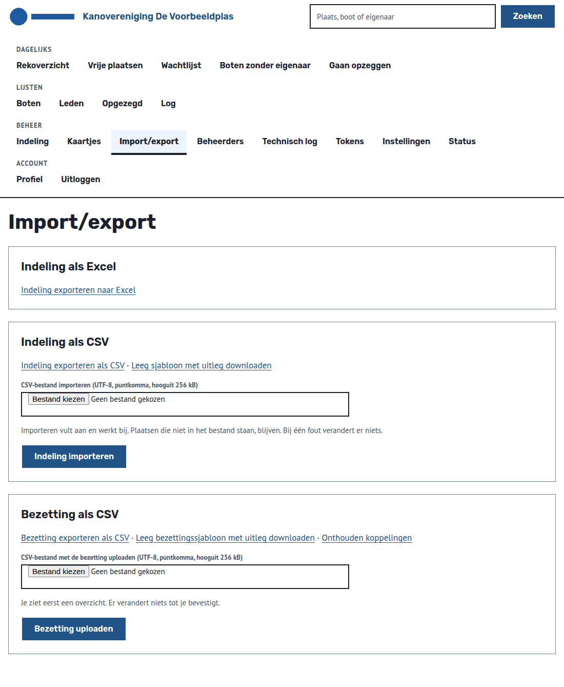

## Indeling als CSV exporteren en importeren

Op `/import-export` staan onder **Indeling als CSV** twee downloads en een uploadformulier. **Indeling exporteren als CSV** geeft `rekindeling.csv` met een regel per plaats. **Leeg sjabloon met uitleg downloaden** geeft `rekindeling-leeg.csv`: de kopregel, de uitleg en een voorbeeldregel, alles als commentaar.

De kolommen zijn `rek`, `omschrijving`, `verdieping`, `vak`, `bootsoorten` en `clubplaats`. Zet bij `bootsoorten` de namen zoals de applicatie ze toont, gescheiden door een `/`, bijvoorbeeld `Kajak/Surfski`. Een lege cel betekent "geen bootsoort"; dat kan alleen bij een nieuwe plaats of een plaats die al geen bootsoort heeft. Bij `clubplaats` staat `ja` of `nee`. De omschrijving is op alle regels van hetzelfde rek gelijk.

Het bestand is UTF-8 met puntkomma's, zoals Excel in het Nederlands het opent en opslaat (kies "CSV UTF-8"). Een regel die met `#` begint, is commentaar. Het bestand is hooguit 256 kB en heeft hooguit 2000 regels. Een tekst die met `=`, `+`, `-` of `@` begint, krijgt in de export een `'` ervoor, zodat Excel er geen formule van maakt. De import haalt die `'` weer weg.

**Importeren** vult aan en werkt bij. Een nieuw rek of een nieuwe plaats komt erbij en een bestaande plaats krijgt de waarden uit het bestand. Een rek wordt herkend aan zijn naam, een plaats aan rek, verdieping en vak. Plaatsen die niet in het bestand staan, blijven. Een rek hernoemen kan alleen op het scherm. Je moet kort geleden zijn ingelogd; anders log je opnieuw in.

Staat er een fout in het bestand, dan verandert er niets en noemt het scherm elke foute regel met het regelnummer en de reden. Fouten zijn bijvoorbeeld een onbekende bootsoort, een gat in een verdieping, een verkeerd scheidingsteken en een bezette plaats die ongeschikt wordt voor haar boot of van clubplaats verandert. Een export die je ongewijzigd importeert, verandert niets. Je vindt de wijziging terug in het technische log (`indeling.geimporteerd`, alleen aantallen) en in het rekoverzicht.

## Bezetting als CSV exporteren en importeren

Op `/import-export` staat onder **Bezetting als CSV** een export, een leeg sjabloon, een uploadformulier en een link naar de onthouden koppelingen. De export geeft `bezetting.csv` met een regel per bezette plaats. De kolommen zijn `plaats` (zoals `A/1/1`), `boot`, `bootsoort`, `eigenaar` en `lidnummer`. Een clubboot heeft in de kolom `eigenaar` het woord `clubboot` (hoofdletters tellen niet mee) en een leeg lidnummer. Heet een lid zelf "clubboot", dan staat in de export het lidnummer erbij en koppelt de import op dat lidnummer. Een clubboot met een lidnummer dat bij geen lid hoort, weigert de import. Zijn eigenaar en lidnummer beide leeg, dan is de eigenaar onbekend: de boot komt op Boten zonder eigenaar en past op een gewone plaats. Voor het bestand gelden dezelfde regels als bij de indeling: UTF-8, puntkomma's, commentaar met `#`, hooguit 256 kB.

Na het uploaden zie je een overzicht, en er verandert nog niets. Elke regel heeft een uitkomst:

| Uitkomst | Betekenis |
|---|---|
| ongewijzigd | De boot ligt al op die plaats. |
| toewijzen | De plaats is vrij. |
| overschrijven | Er ligt een andere boot. Die gaat van de plaats en blijft bestaan. |
| verplaatsen | De boot ligt elders en komt hierheen. |
| nieuwe boot | De boot bestaat nog niet en wordt aangemaakt. |
| te koppelen | Er is nog geen lid gekozen. |
| fout | Bijvoorbeeld een onbekende plaats of bootsoort (kies de soort in de lijst), een boot die niet past, een oud-lid of een dubbele regel. |
| overgeslagen | Jij sloeg de regel over. |

Het lidnummer gaat voor. Zonder lidnummer, of met een onbekend nummer, zoekt de import een onthouden koppeling of een lid met exact die naam. Past er niet precies één lid, dan kies je zelf een lid of de vereniging, of sla je de regel over, en kies je **Keuzes opslaan**. Die keuze wordt onthouden voor een volgende import. Op **Onthouden koppelingen** verwijder je ze weer. Een koppeling vervalt met het lid en vijf jaar na het laatste gebruik.

Staat er in het bestand een bootsoort die de applicatie niet kent, bijvoorbeeld een spelfout, dan kies je bij die regel in de lijst **Bootsoort** een van de soorten die de plaats toelaat, of je slaat de regel over. Is de plaats zelf onbekend of fout, dan kun je de regel alleen overslaan. Past ook de eigenaar niet, dan staan er twee lijsten onder elkaar, **Bootsoort** en **Eigenaar**. De gekozen bootsoort geldt alleen voor deze import en wordt niet onthouden. Je kunt beide keuzes na **Keuzes opslaan** nog wijzigen.

**Bezetting importeren** kan pas als geen regel nog te koppelen is of een fout heeft. Het is alles of niets. Een oud-lid krijgt geen nieuwe plaats of boot, en een bestaande boot wijzigt de import niet. De import verloopt na twee uur. Er is één lopende import voor de hele vereniging: elke beheerder kan hem koppelen, bevestigen of annuleren. De bootmutaties staan in het mutatielog en de aantallen in het technische log (`bezetting.geimporteerd`).

## Kaartjes printen

Op `/kaartjes` kies je voor welke plaatsen je een kaartje wilt. Elk rek heeft een eigen vak dat altijd open staat. Vink losse plaatsen aan, een heel rek (**Heel** en de naam van het rek) of **Alle plaatsen**, en kies **Kaartjes maken**. Je krijgt de printpagina `/kaartjes/print` met acht kaartjes per A4, in twee kolommen en vier rijen.

Elk kaartje toont het logo (zonder logo de naam van de vereniging), de aanduiding van de plaats, de bootsoorten waarvoor de plaats geschikt is (bijvoorbeeld "Geschikt voor Kajak/Canadese kano") en een QR-code. Heeft de plaats geen bootsoort, dan valt die regel weg. De omschrijving van het rek en de naam van de eigenaar staan er niet op, zodat je geen nieuw kaartje hoeft te printen als een plaats een andere boot krijgt. Wie op de plaats ligt, staat op de openbare pagina achter de QR-code. Adres, telefoon, e-mail en lidnummer staan nooit op een kaartje.

Print de pagina met **Afdrukken** in de browser, of bewaar haar als pdf. Zet de schaal op 100 procent en de marges op standaard. Knip langs de stippellijnen.

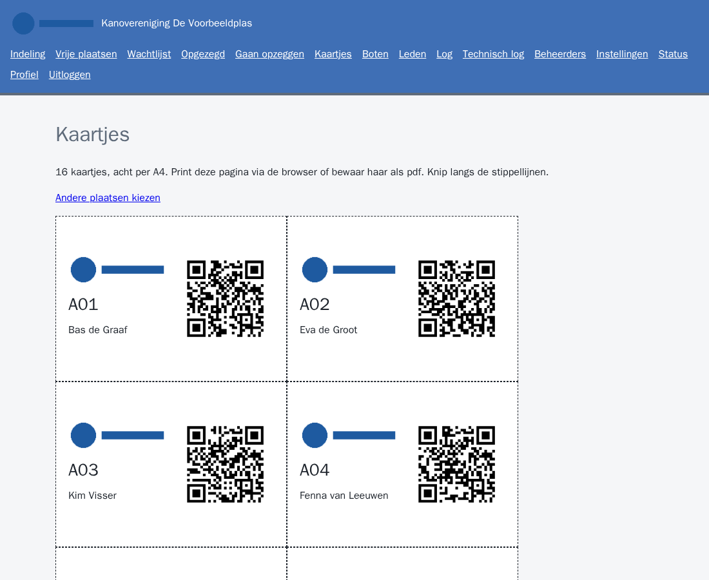

De QR-code opent de openbare pagina van de plaats. Krijgt het rek een andere naam, dan blijft het oude kaartje naar dezelfde plaats wijzen; alleen de aanduiding op het kaartje is verouderd. Print dan een nieuw kaartje.

## De openbare pagina

Elke plaats heeft een openbare pagina op `/p/` met een lange, niet te raden sleutel. Je vindt de link op de pagina van de plaats, onder **Openbare pagina**. Wie de link opent, hoeft niet in te loggen. De pagina begint met de aanduiding van de plaats en een label: **Bezet**, **Clubplaats** of **Vrij**. **Clubplaats** staat alleen bij een clubplaats; een clubboot op een gewone plaats staat bij **Bezet**. Daaronder staat de zin "Hier hoort de boot van eigenaar", bij een clubboot met de vereniging als eigenaar en bij een onbekende eigenaar zonder eigenaar, met de foto van de boot ernaast of eronder. Een vrije plaats zegt dat ze vrij is en wijst wie een plaats wil naar de beheerder. Een vrije clubplaats zegt dat ze voor een clubboot is. Onderaan staat de omschrijving van het rek, als die er is. Er is geen zoekfunctie, geen menu en geen link vanaf het logo, en er staan geen adresgegevens op. De pagina gebruikt de naam en het logo van de vereniging.

## Leden en de import

De ledenlijst komt uit de ledenbron. Je maakt of wijzigt leden niet in de applicatie. De integratiecontainer haalt de lijst dagelijks op en stuurt haar naar de applicatie.

Op `/leden` staat per lid de naam, het lidnummer, de datum van lid sinds en of het een lid of oud-lid is, met het aantal leden erboven. Zoek op naam of lidnummer en kies **Zoeken**; hoofdletters en accenten tellen niet mee. Het blok **Import** met de knop **Leden nu ophalen** en de laatste importruns is dicht; open het met een klik. Een lid opent op `/leden/` met zijn boten en plaatsen. Een lid met een opzegdatum van vandaag of eerder heet oud-lid; zijn gegevens en plaatsen blijven staan. De import neemt geen oud-leden op die nog niet in de applicatie stonden: een lid dat al is opgezegd, komt er niet in en telt als overgeslagen. Een lid dat later opzegt, blijft staan, zodat zijn boot als boot van een oud-lid wordt herkend. Een opzegdatum in de toekomst komt wel binnen.

Op de pagina van een lid staan de boten als lijst, met bootsoort en plaats. De aantallen per bootsoort staan niet op deze pagina. De integratiecontainer haalt ze op via de API: alleen boten met een plaats tellen, een boot op de wachtlijst of zonder plaats telt niet, een clubboot ook niet, en de ledenadministratie kan ze later overnemen. Terugschrijven naar de ledenbron staat standaard uit; de beheerder kan het aanzetten.

**Bewaartermijn.** Elke nacht om 04:00 verwijdert de applicatie gegevens die ouder zijn dan 5 jaar. Een oud-lid verdwijnt 5 jaar na de opzegdatum, met zijn boten en foto's. Heeft een boot van het oud-lid nog een plaats, dan blijft alles staan tot je de plaats vrijgeeft. Een regel in een log verdwijnt 5 jaar na de wijziging. Een verwijderd oud-lid komt niet terug met de volgende import, want de import neemt geen opgezegd lid op dat nog niet in de applicatie stond. In de logs blijft een verwijderd lid staan als `lid:` met een nummer, zonder naam.

**Een import aanvragen.** Kies op `/leden` bij **Import** de knop **Leden nu ophalen**. De integratiecontainer begint binnen een minuut. Ververs daarna de pagina. Een tweede verzoek terwijl er al een klaarstaat, weigert de applicatie.

**De uitkomst lezen.** De tabel toont de laatste vijf imports met tijdstip, status en resultaat.

| Status | Betekenis |
|---|---|
| aangevraagd | Het verzoek wacht op de integratiecontainer. |
| geslaagd | De import is verwerkt. Het resultaat telt de leden: ontvangen, nieuw, bijgewerkt, overgeslagen, ongeldig en uit_bron (leden die in de bron ontbraken en oud-lid zijn geworden). |
| mislukt | Het resultaat noemt de reden: de ledenbron is niet bereikbaar, het antwoord is onleesbaar, of de bron weigerde de inloggegevens. De ledenlijst is dan niet gewijzigd. |

Blijft een verzoek op aangevraagd staan, dan draait de integratiecontainer waarschijnlijk niet. Meld dat aan wie de installatie beheert.

## Het mutatielog

Elke wijziging van een beheerder en elke wijziging door een robottoken komt in een log, met tijdstip, wie het deed, de handeling, waarop die betrekking had en een paar gegevens. Een log kan niet worden aangepast. Een wijziging van een lid door de import staat er niet in, een wijziging in de botenadministratie als gevolg daarvan wel. In het mutatielog staat de handeling als tekst, zoals "plaats toegewezen" of "boot aangemaakt". Het technische log toont de handeling zoals de applicatie ze opslaat, in de vorm onderwerp.handeling, zoals `token.gemaakt`.

Er zijn twee logs. Elke beheerder ziet ze allebei.

| Log | Menu | Inhoud |
|---|---|---|
| Mutatielog (`/log`) | **Log** | Boten aangemaakt, gewijzigd of verwijderd, een foto toegevoegd of vervangen, een plaats toegewezen of vrijgegeven, een boot verplaatst ("boot verplaatst"), een boot op de wachtlijst gezet ("wachtlijst toegevoegd", met de aanmelddatum) of eraf gehaald ("wachtlijst verwijderd") |
| Technisch log (`/log/techniek`) | **Technisch log** | Tokens, geweigerde API-aanroepen, beheerders en inlogmethodes, instellingen, importverzoeken, de indeling (rekken aanmaken, wijzigen of verwijderen, en plaatsen die erbij komen, wijzigen of verdwijnen), de bootsoorten en de nachtelijke opschoning (`opschoning.uitgevoerd`, met alleen de aantallen) |

Het mutatielog toont bij elke regel waarop de handeling betrekking had als tekst: "Plaats B/2/2", "Rek B", "Boot Zeemeeuw" en "Lid Anna de Vries (1001)". Bestaat een boot of lid niet meer, dan staat de verwijzing er zoals opgeslagen, bijvoorbeeld `boot:183`. Het technische log toont de verwijzingen zoals opgeslagen. Beide tonen per pagina 50 regels, de nieuwste bovenaan, onder een kop per dag met de weekdag (in de tijdzone van de installatie, niet in UTC); met **Oudere regels** en **Nieuwere regels** blader je verder. Onder een overzicht staat het log in een uitklapblok **Log** dat dicht begint; open het met een klik. Een overzicht toont hooguit 50 regels; toont het er 50, dan opent **Meer in het log** het hele log. Onder een boot staan de mutaties van die boot, onder een lid de mutaties van de boten van dat lid en onder een plaats de toewijzingen, vrijgaven en verplaatsingen op die plaats. De wachtlijst toont de handelingen op de wachtlijst. De overzichten van vrije plaatsen en van (gaan) opzeggen tonen de toewijzingen, vrijgaven en verplaatsingen op hun plaatsen. Onder `/indeling` en de schermen voor beheerders, profiel, leden en instellingen staat geen log; zoek die wijzigingen in het technische log.

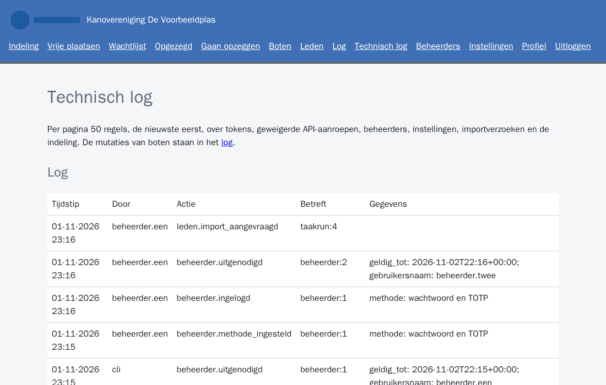

## De technische status

Onder **Status** (`/status`) zie je of de installatie goed draait. Elk onderdeel heeft de status ok, waarschuwing of fout.

| Onderdeel | Wat je ziet | Waarschuwing als |
|---|---|---|
| Database | versie van PostgreSQL en van de migratie | de migratie niet de verwachte is (fout) |
| Worker | laatste heartbeat | die ouder is dan 2 minuten |
| Import van leden | laatste import met resultaat, aantallen en bij een fout de reden; laatste geslaagde import | de laatste import mislukte, of de laatste geslaagde is ouder dan 26 uur |
| Opschoning | laatste opschoning met het aantal verwijderde logregels, leden, boten, foto's, verlopen imports en koppelingen | de laatste opschoning mislukte; de worker probeert het de volgende nacht opnieuw |
| API | aan of uit | |
| Bootaantallen | wanneer de integratiecontainer ze voor het laatst ophaalde | |
| Tokens die verlopen | tokens die binnen 31 dagen verlopen, met naam en vervaldatum | er zo'n token is |

Onderaan staat per robottoken de laatste aanroep. De pagina toont geen tokenwaarden, wachtwoorden of gegevens van leden. Dezelfde gegevens staan als JSON op `/status.json`, voor wie de installatie bewaakt.

Een waarschuwing bij de import betekent meestal dat de integratiecontainer niet draait of dat zijn token verlopen is. Een token dat bijna verloopt, vervang je op tijd; dat doet wie de installatie beheert.

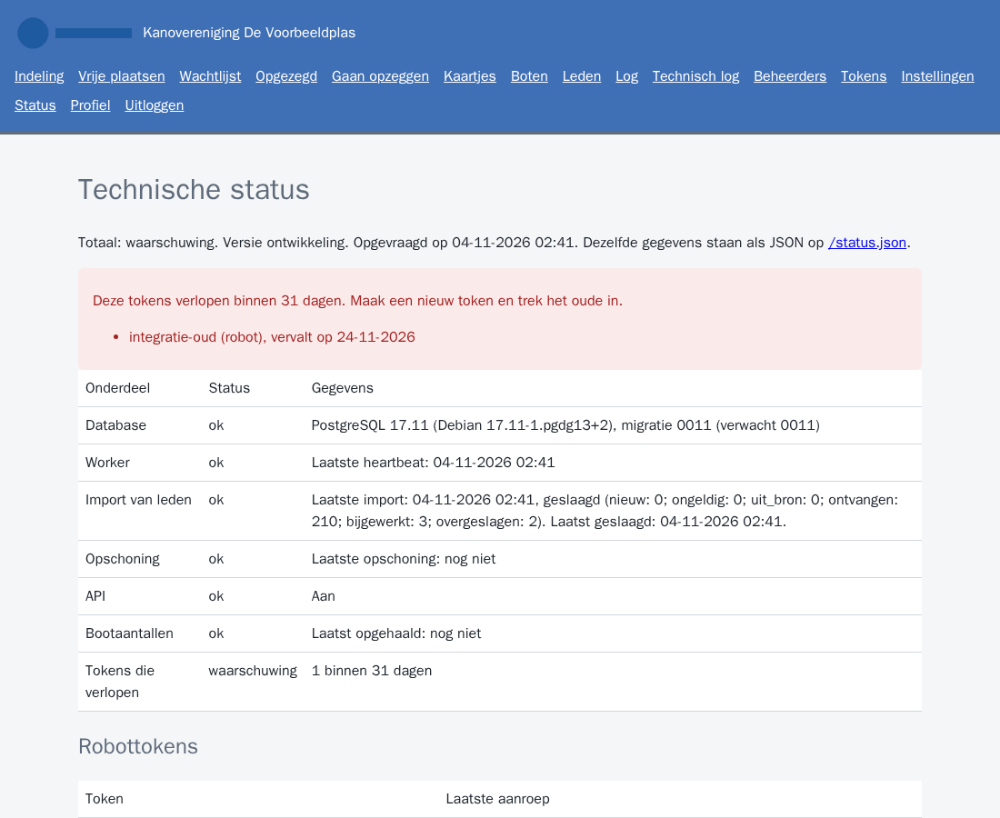

## Tokens voor de API

Met een token gebruik je de API (`/api/v1`) zonder je wachtwoord te delen. Onder **Tokens** (`/tokens`) staan alle tokens van de installatie, met naam, soort, eigenaar of maker, rechten, whitelist, vervaldatum, laatste gebruik en de datum van intrekken. De waarde van een token staat er nooit. Elke beheerder ziet en beheert alle tokens, ook die van een collega.

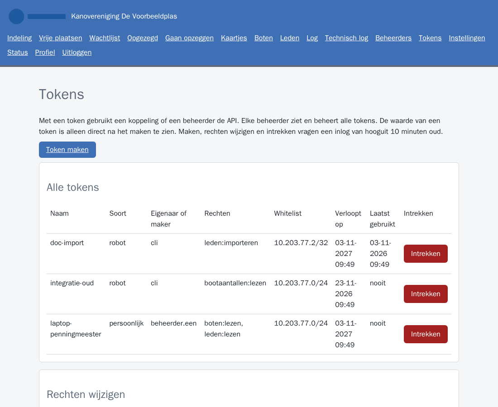

Er zijn twee soorten tokens:

| Soort | Hoort bij | Werkt niet meer als |
|---|---|---|
| Persoonlijk | de beheerder die het maakt | het verloopt, is ingetrokken, of het account geblokkeerd of verwijderd is. Na deblokkeren werkt het weer; na toegang herstellen blijft het werken |
| Robot | een koppeling, zoals de integratiecontainer | het verloopt of is ingetrokken. Het blijft werken als de maker vertrekt; de naam van de maker blijft in het overzicht staan |

### Een token maken

1. Kies **Token maken** (`/tokens/nieuw`).
2. Kies onder **Wie en hoe lang** de soort, een naam (a-z, cijfers, punt, - en _) en hoeveel dagen het geldig is: standaard 365, hooguit 1095 (3 jaar).
3. Vink onder **Wat mag het token** minstens één recht aan. `leden:importeren` staat er niet bij: dat recht geeft wie de installatie beheert met de CLI, aan het robottoken van de integratiecontainer.
4. Vul de IP-whitelist in: adressen of reeksen, gescheiden door komma's. Het formulier vult het netwerk van de integratiecontainer voor. Een robottoken heeft altijd een whitelist, zonder reeksen breder dan /8 (IPv4) of /32 (IPv6), dus niet `0.0.0.0/0` of `::/0`; een persoonlijk token zonder whitelist werkt vanaf elk adres dat de installatie doorlaat.
5. Kopieer de waarde die verschijnt. Ze staat onder een waarschuwing in een kader; met één tik selecteer je haar helemaal. Er is geen kopieerknop. De waarde is daarna niet meer te zien; ben je haar kwijt, maak dan een nieuw token en trek het oude in.

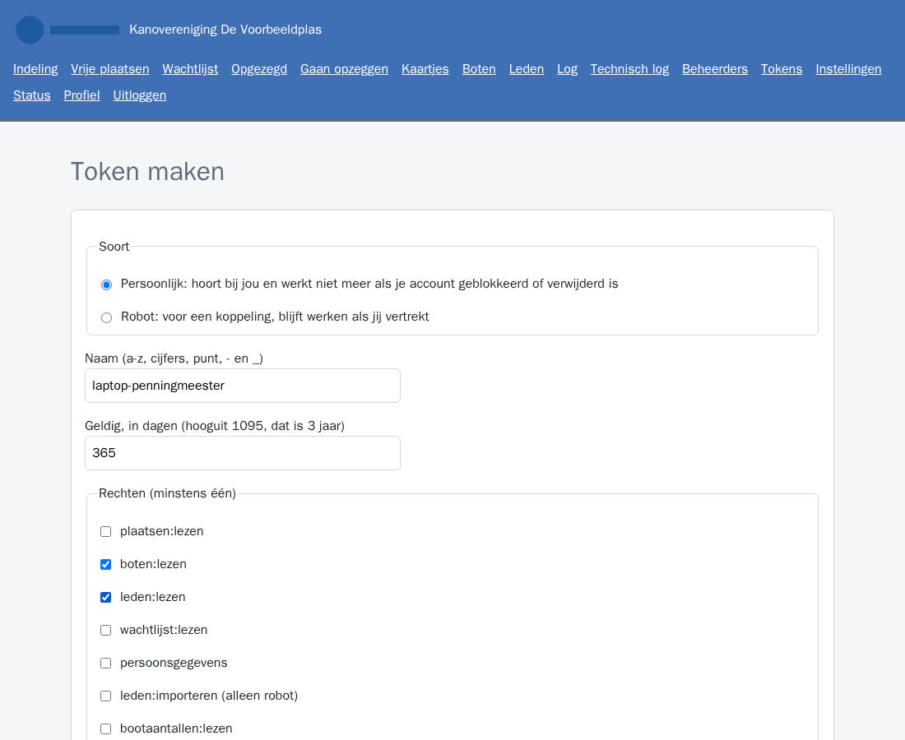

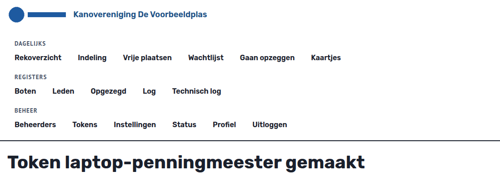

Een persoonlijk token werkt alleen als wie de installatie beheert de API van buiten heeft opengezet. Zonder dat laat de installatie alleen de integratiecontainer bij de API.

| Recht | Geeft |
|---|---|
| `plaatsen:lezen` | alle plaatsen met rek, clubplaats, bootsoorten en boot |
| `boten:lezen` | alle boten met bootsoort, plaats en naam en lidnummer van de eigenaar |
| `leden:lezen` | alle leden met naam, lidnummer, of het een oud-lid is, en de datums van lidmaatschap en opzegging |
| `wachtlijst:lezen` | de wachtlijst per bootsoort met aanmelddatum |
| `leden:importeren` | de import van leden, alleen voor de integratiecontainer en alleen met de CLI te geven |
| `bootaantallen:lezen` | het aantal boten per bootsoort per lid |

### Rechten wijzigen en intrekken

Onder **Rechten wijzigen**, onder de lijst, klap je een token uit, pas je de vinkjes aan en kies je **Rechten opslaan**. De nieuwe rechten gelden vanaf de volgende aanroep. Heeft een token `leden:importeren`, dan blijft dat recht staan; het is alleen met de CLI te geven of af te nemen.

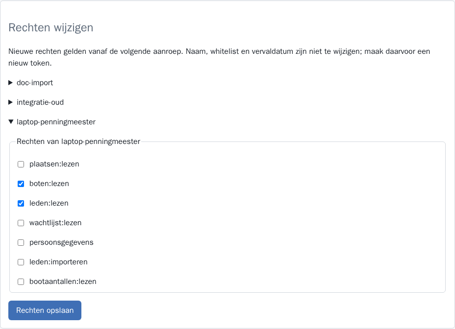
 **Intrekken** werkt direct: de volgende aanroep met dat token wordt geweigerd. Naam, whitelist en vervaldatum zijn niet te wijzigen; daarvoor maak je een nieuw token.

Maken, rechten wijzigen en intrekken vragen een inlog van hooguit 10 minuten oud. Elke handeling staat in het technische log, zonder de waarde van het token.

## Naam, logo en bootsoorten

Op `/instellingen` pas je de naam van de vereniging aan. Ze staat op elke pagina, ook de openbare. De kleuren zijn vast en niet in te stellen. Opslaan vraagt een inlog van hooguit 10 minuten oud.

In het blok **Logo** upload je het logo van de vereniging: kies een bestand in JPEG, PNG of WebP tot 10 MB en kies **Logo opslaan**. De applicatie verkleint het tot 800 pixels en haalt de gegevens uit het bestand weg, zoals de locatie. Het logo staat direct in de kopbalk, op de openbare pagina's en op de kaartjes, en een nieuw logo vervangt het vorige. **Logo verwijderen** haalt het weg; dan toont de kopbalk alleen de naam. Beide vragen een inlog van hooguit 10 minuten oud. Is het bestand groter dan 10 MB of geen geldige afbeelding, dan blijft het vorige logo staan, als er een is, en staat het blok open met de melding. Een bestand boven 25 MB weigert de server met een foutpagina zonder uitleg.

In het blok **Bootsoorten** staan de soorten die je bij boten en plaatsen kiest. Het blok staat dicht, en na elke handeling hier open. Ook elke wijziging vraagt een inlog van hooguit 10 minuten oud.

- **Toevoegen:** vul onder **Nieuwe bootsoort** een naam in van 1 tot 50 tekens en kies **Bootsoort toevoegen**. De soort staat daarna in de keuzelijsten voor boten, plaatsen en vrije plaatsen. Zodra een boot van die soort op de wachtlijst staat, heeft de soort een eigen lijst op `/wachtlijst`.
- **Hernoemen:** pas de naam aan en kies **Naam opslaan**. Boten, plaatsen, wachtlijst, export en API tonen direct de nieuwe naam. Toewijzingen en aanmelddata blijven gelijk.
- **Verwijderen:** kies **... verwijderen**. Gebruikt een boot of plaats de soort nog, dan weigert de applicatie en noemt ze de aantallen. Geef die boten een andere soort of verwijder ze, en haal de soort weg bij die plaatsen.

Twee soorten met dezelfde naam kunnen niet, ook niet als ze alleen in hoofdletters verschillen. Toevoegen, hernoemen (met de oude en de nieuwe naam) en verwijderen staan in het technische log.

## Alle adressen

Wat tussen accolades staat, vult de applicatie zelf in.

| Adres | Pagina |
|---|---|
| `/` | Stuurt een beheerder naar het rekoverzicht en een bezoeker naar het inloggen |
| `/inloggen` | Inloggen |
| `/inloggen/code` | Code uit de authenticator-app |
| `/uitnodiging/{code}` | Account instellen met een uitnodigingslink |
| `/profiel` | Je inlogmethodes |
| `/beheerders` | Beheerders uitnodigen en beheren |
| `/tokens` | Tokens voor de API |
| `/tokens/nieuw` | Een token maken |
| `/indeling` | Rekken, omschrijvingen en plaatsen |
| `/import-export` | Indeling en bezetting exporteren en importeren |
| `/indeling.xlsx` | Export naar Excel |
| `/rekindeling.csv` | Export van de indeling als CSV, met `?leeg=1` het sjabloon |
| `/bezetting.csv` | Export van de bezetting als CSV, met `?leeg=1` het sjabloon |
| `/bezetting/import` | Overzicht en koppelscherm van de lopende bezettingsimport |
| `/bezetting/import/koppelen` | Keuzes van de import opslaan |
| `/bezetting/import/bevestigen` | De lopende import uitvoeren |
| `/bezetting/import/annuleren` | De lopende import weghalen |
| `/bezetting/koppelingen` | Onthouden koppelingen |
| `/bezetting/koppelingen/{nummer}/verwijderen` | Een koppeling verwijderen |
| `/rekoverzicht` | Plaatje per plaats, per rek |
| `/kaartjes` | Plaatsen kiezen voor kaartjes |
| `/kaartjes/print` | Kaartjes met QR-code om te printen |
| `/plaatsen/{nummer}` | Een plaats, toewijzen en vrijgeven |
| `/boten` | Boten |
| `/boten/{nummer}` | Een boot, een plaats toewijzen of de boot verplaatsen |
| `/vrij` | Vrije plaatsen |
| `/wachtlijst` | Wachtlijst per bootsoort |
| `/zoeken` | Zoeken vanuit de kop, de lijst met treffers |
| `/boten/zonder-eigenaar` | Boten met een onbekende eigenaar, een eigenaar kiezen |
| `/opgezegd` | Plaatsen van opgezegde leden |
| `/opzeggend` | Boten van leden die gaan opzeggen |
| `/leden` | Leden en de import |
| `/leden/{nummer}` | Een lid |
| `/log` | Mutatielog: boten en plaatsen |
| `/log/techniek` | Technisch log |
| `/instellingen` | Naam, logo en bootsoorten |
| `/status` | Technische status |
| `/status.json` | Technische status als JSON |
| `/p/{sleutel}` | Openbare pagina van een plaats |
| `/afbeelding/{sleutel}` | Foto op de pagina van een boot of plaats |
| `/logo/{kenmerk}` | Logo in de kopbalk |

Ververs de afbeeldingen met `documentatie/gebruikers/schermafbeeldingen.sh` (start een eigen testomgeving en ruimt die op).
