# Handleiding voor beheerders van de botenloods

Met botenloodsbeheer houd je bij welke boot op welke plaats in de loods ligt en van wie die is. Deze handleiding beschrijft per taak wat je kunt doen en hoe. Ze geldt voor een loods van ongeveer 10 rekken, 160 plaatsen, 210 leden en 180 boten, met 3 beheerders die dezelfde rechten hebben. Er is geen aparte systeembeheerder in de applicatie.

Alle schermen werken in een gewone browser, ook op een telefoon. Elk scherm met gegevens toont onderaan het log van de mutaties die erbij horen. De voorbeelden en afbeeldingen gebruiken verzonnen gegevens.

## Inloggen

Je logt in met een passkey (telefoon, vingerafdruk of beveiligingssleutel) of met een wachtwoord plus een code uit een authenticator-app. Een passkey is het eenvoudigst en niet te phishen.

1. Open `/inloggen`.
2. Kies **Inloggen met passkey** en volg de vraag van je apparaat. Of vul je gebruikersnaam en wachtwoord in en kies **Verder**.
3. Bij een wachtwoord vraagt de applicatie daarna de code van zes cijfers uit je authenticator-app.

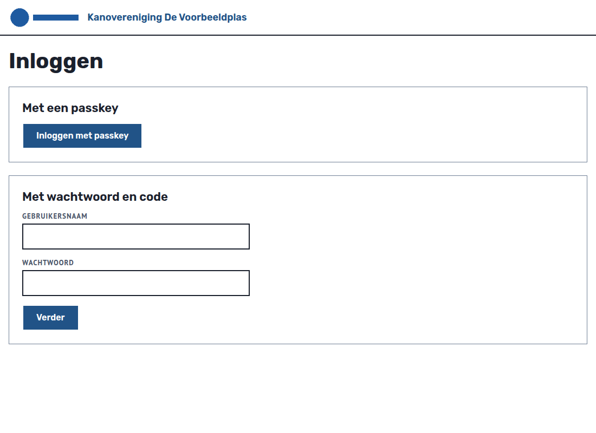

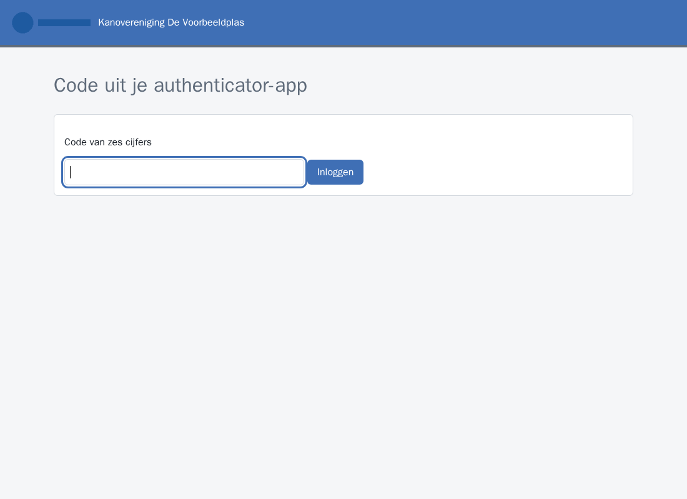

Na vijf mislukte pogingen kun je 15 minuten niet met je wachtwoord inloggen. Met een passkey lukt het wel. De applicatie zegt niet of de gebruikersnaam of het wachtwoord fout was. Een sessie duurt 12 uur. Met **Uitloggen** in de menubalk sluit je hem eerder af.

Een paar handelingen vragen een inlog van hooguit 10 minuten oud: een beheerder uitnodigen of herstellen, inlogmethodes wijzigen en de instellingen opslaan. Is je inlog ouder, dan vraagt de applicatie je opnieuw in te loggen.

## Beheerders

Het scherm `/beheerders` toont alle accounts met hun status en inlogmethodes. De eerste beheerder maakt wie de installatie beheert (zie de beheerdocumentatie). Daarna nodigen jullie elkaar uit.

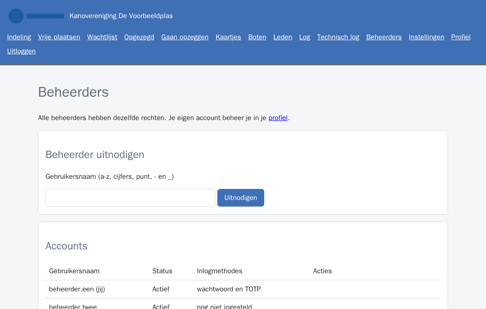

### Een beheerder uitnodigen

1. Vul onder **Beheerder uitnodigen** een gebruikersnaam in (2 tot 50 tekens: a-z, cijfers, punt, streepje en onderstreping) en kies **Uitnodigen**.
2. Geef de link die verschijnt aan de nieuwe beheerder. De link werkt één keer en is 24 uur geldig. Hij staat alleen op dit scherm.
3. De nieuwe beheerder opent de link en kiest een passkey, of een wachtwoord van 12 tot 128 tekens met de QR-code of sleutel voor de authenticator-app en een eerste code.

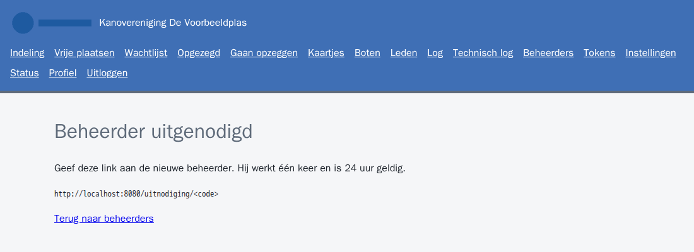

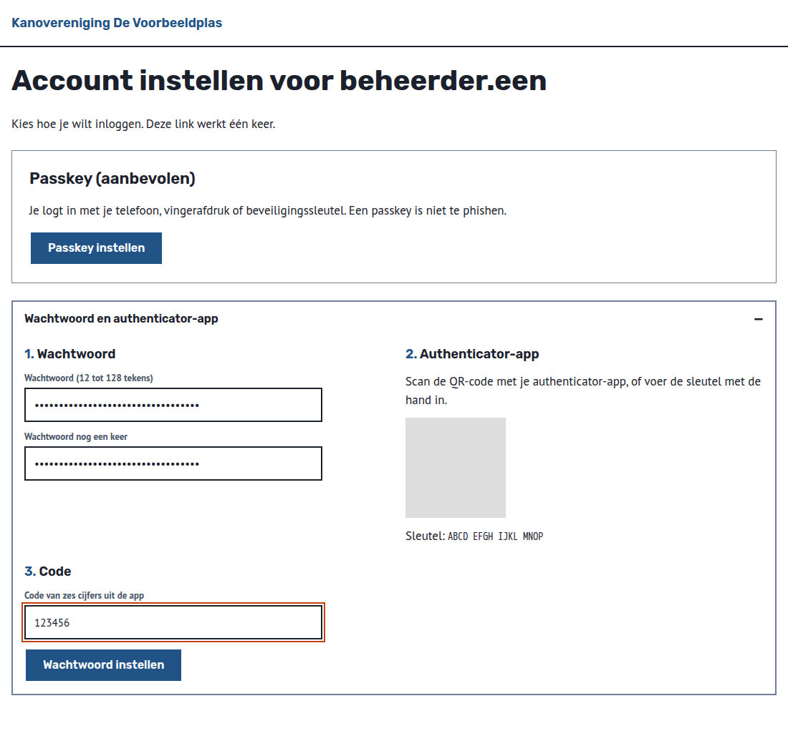

### Een collega blokkeren, herstellen of verwijderen

Achter elk ander account staan drie knoppen. Je eigen account kun je hier niet wijzigen, zodat er altijd een actieve beheerder blijft.

| Knop | Gevolg |
|---|---|
| Blokkeren | De beheerder kan niet meer inloggen. **Deblokkeren** maakt dat ongedaan. |
| Toegang herstellen | Oude inlogmethodes en sessies vervallen. Je krijgt een nieuwe link van 24 uur voor de collega, bijvoorbeeld na een verloren telefoon. |
| Verwijderen | Het account verdwijnt. Het log blijft. |

### Je eigen inlogmethodes

Op `/profiel` voeg je een passkey of (als je er nog geen hebt) een wachtwoord met authenticator-app toe, of trek je een methode in. Intrekken beëindigt al je sessies. Je houdt altijd minstens één methode.

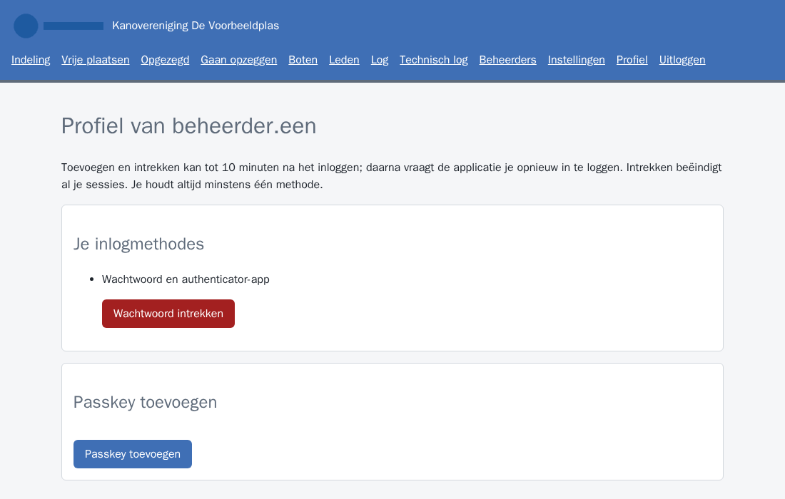

## Rekken en plaatsen

De pagina `/indeling` toont elk rek met zijn plaatsen. Per plaats staan de code, de status (vrij, bezet of clubplaats), de boot, de eigenaar en de bootsoorten waarvoor de plaats geschikt is. Een clubplaats is alleen voor boten van de vereniging.

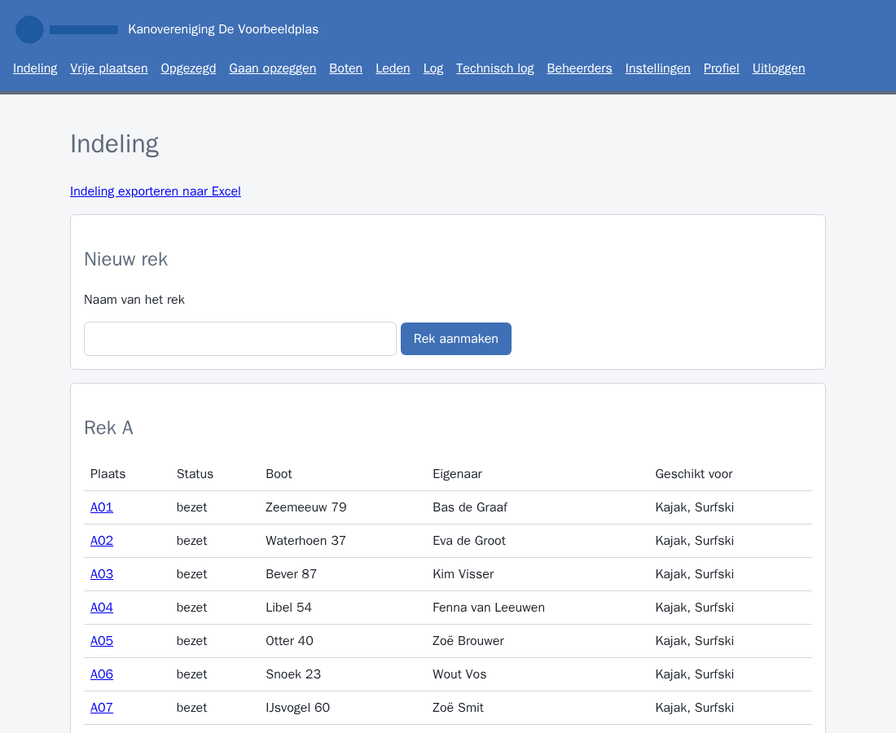

- **Rek aanmaken:** vul bovenaan een naam in (1 tot 50 tekens) en kies **Rek aanmaken**.
- **Plaats toevoegen:** open onder een rek **Plaats toevoegen aan ...**, vul een code in (1 tot 20 tekens, uniek in de hele loods), vink minstens één bootsoort aan en eventueel **Clubplaats**.
- **Rek hernoemen of verwijderen:** open **Rek wijzigen of verwijderen**. Een rek verwijderen lukt alleen als er geen boten meer op liggen.
- **Plaats wijzigen of verwijderen:** open de plaats via de code. Onder **Plaats wijzigen** pas je code, bootsoorten en clubstatus aan. Verwijderen kan alleen bij een vrije plaats. Een wijziging die niet past bij de boot die er ligt, weigert de applicatie.

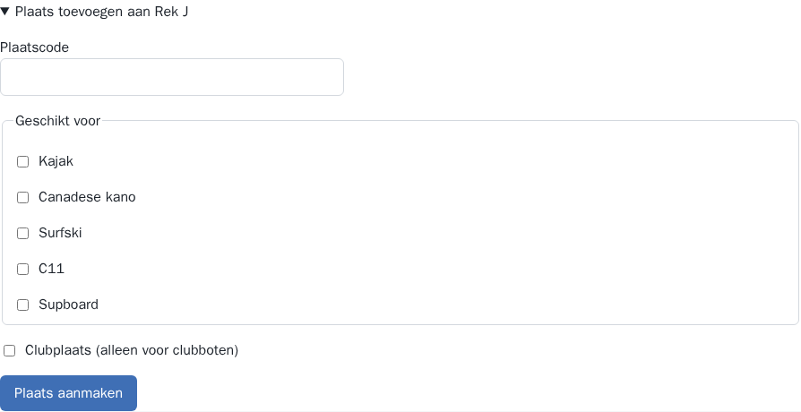

De bootsoorten (zoals kajak, surfski, canadese kano, C11 en supboard) staan vast in de applicatie. Je kunt ze niet zelf toevoegen.

## Boten

Op `/boten` staan alle boten met bootsoort, eigenaar en plaats. Een boot heeft een naam, een bootsoort en een eigenaar: een actief lid of de vereniging zelf (clubboot).

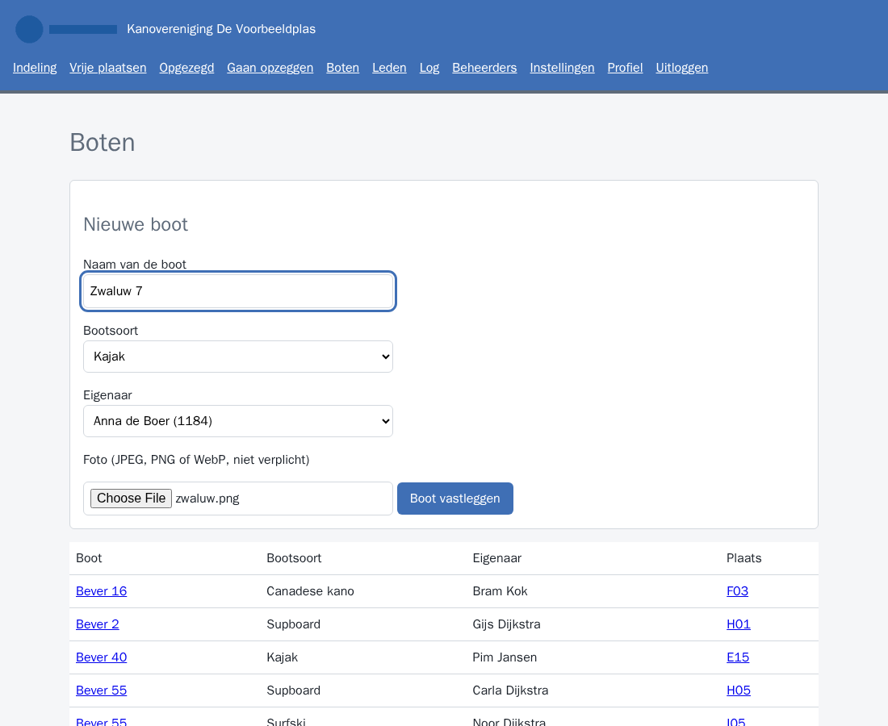

1. Vul de naam in, kies de bootsoort en de eigenaar. Een oud-lid staat niet in de lijst.
2. Voeg eventueel een foto toe (JPEG, PNG of WebP, hooguit 10 MB).
3. Kies **Boot vastleggen**. Je ziet daarna de pagina van de boot.

Een nieuwe boot heeft nog geen plaats. Op de pagina van de boot vervang je de foto of verwijder je de boot. Een boot met een plaats verwijderen weigert de applicatie: geef de plaats eerst vrij.

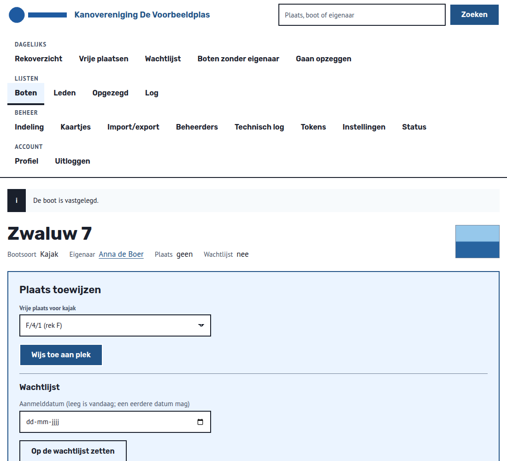

## Een plaats toewijzen of vrijgeven

De applicatie wijst nooit zelf een plaats toe. Jij kiest boot en plaats.

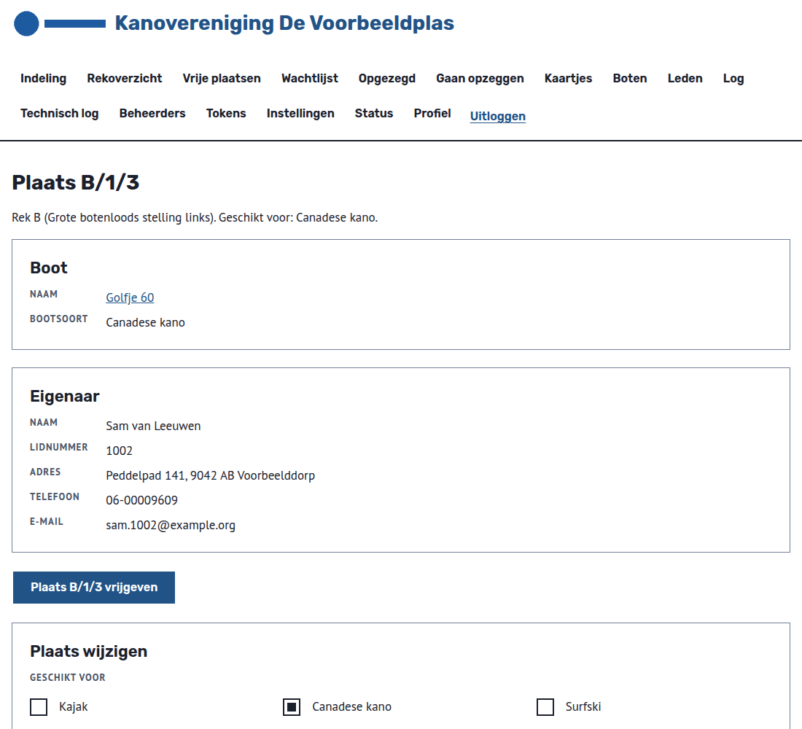

**Toewijzen:** open een vrije plaats (via `/indeling` of `/vrij`), kies onder **Boot zonder plaats** de boot en kies **Plaats toewijzen**. De applicatie weigert in deze gevallen en zegt waarom:

- de plaats is bezet, of de boot heeft al een plaats;
- de plaats is niet geschikt voor de bootsoort;
- een clubboot op een gewone plaats, of een boot van een lid op een clubplaats;
- de eigenaar is oud-lid.

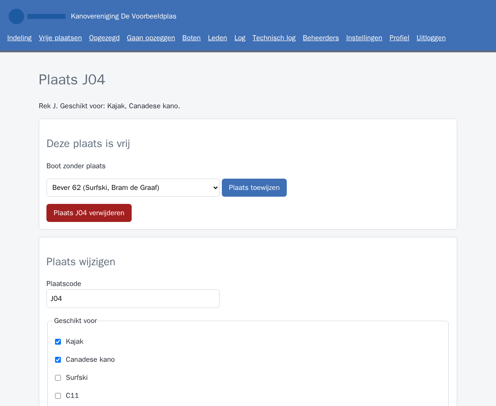

**Vrijgeven:** open de bezette plaats en kies **Plaats ... vrijgeven**. De boot blijft bestaan, zonder plaats. Wie twee collega's tegelijk dezelfde plaats laat vrijgeven, krijgt één wijziging in het log.

Na het toewijzen toont de plaats de boot, de eigenaar met lidnummer, adres, telefoon en e-mail, en de link naar de openbare pagina. Die gegevens zijn alleen voor beheerders.

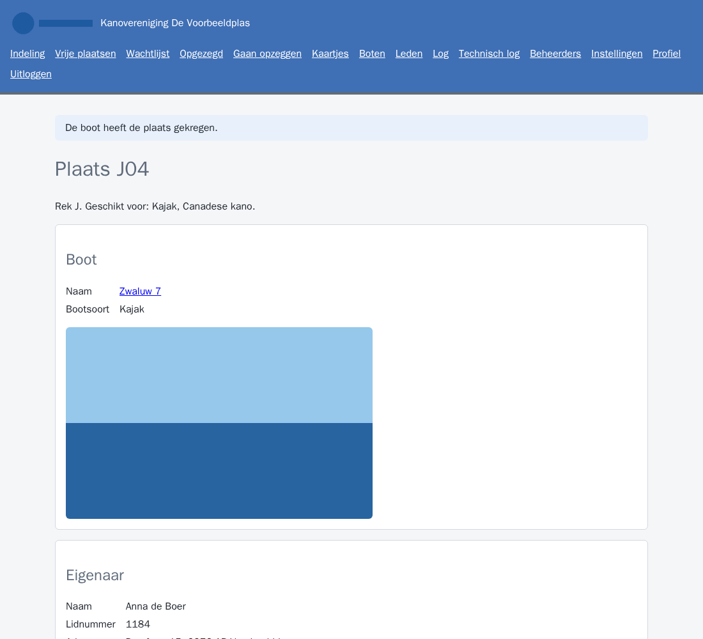

## Overzichten

De menubalk bevat drie overzichten. Ze zijn alleen om te lezen; je werkt vanuit de plaats zelf.

| Menu | Adres | Wat je ziet |
|---|---|---|
| Vrije plaatsen | `/vrij` | Vrije plaatsen voor boten van leden, clubplaatsen niet. Filter op bootsoort. |
| Opgezegd | `/opgezegd` | Boten van oud-leden die nog een plaats hebben, de oudste opzegging bovenaan. |
| Gaan opzeggen | `/opzeggend` | Boten met een plaats van leden met een opzegdatum in de toekomst, de vroegste bovenaan. |

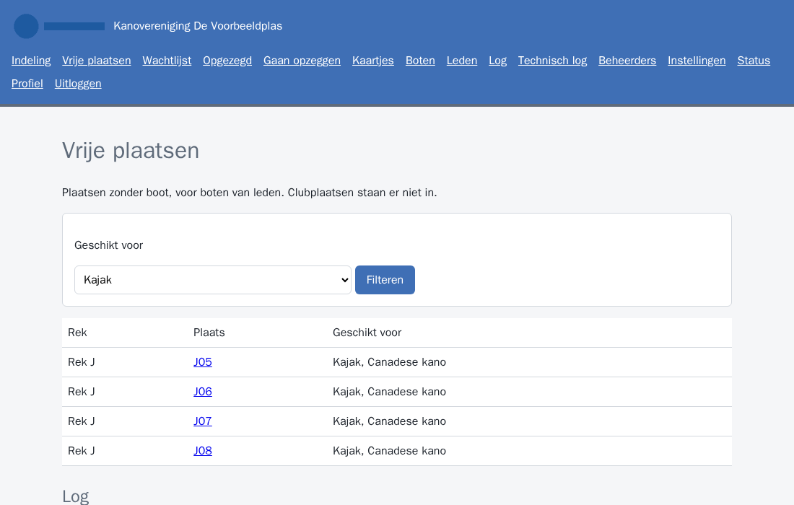

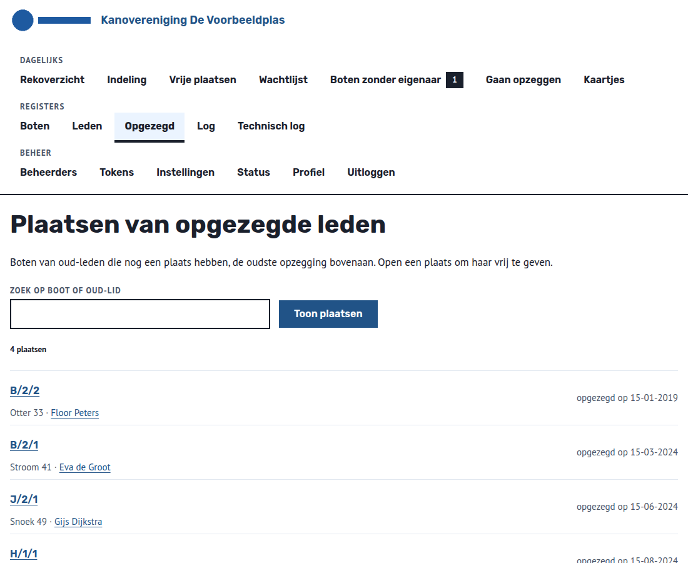

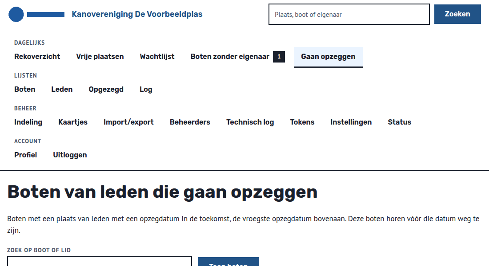

Een lid verhuist van **Gaan opzeggen** naar **Opgezegd** zodra de opzegdatum is bereikt. Open de plaats met de link en geef haar vrij.

## Export naar Excel

Bovenaan `/indeling` staat **Indeling exporteren naar Excel**. Je krijgt het bestand `indeling.xlsx` met een rij per plaats. De kolommen zijn Rek, Code, Status, Bootsoort, Bootnaam, Eigenaar en Lidnummer. Bij een vrije plaats staat in de kolom Bootsoort waarvoor de plaats geschikt is, tussen haakjes. Adres, telefoon, e-mail en foto zitten er bewust niet in.

## De openbare pagina

Elke plaats heeft een openbare pagina op `/p/` met een lange, niet te raden sleutel. Je vindt de link op de pagina van de plaats, onder **Openbare pagina**. Wie de link opent, hoeft niet in te loggen en ziet de plaatscode en of de plaats vrij is, of anders de boot, de eigenaar (bij een clubboot de vereniging) en de foto. Er is geen zoekfunctie en er staan geen adresgegevens op. De pagina gebruikt de naam, kleuren en het logo van de vereniging.

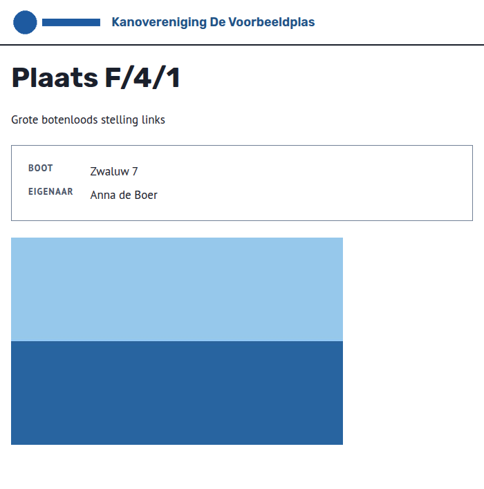

## Leden en de import

De ledenlijst komt uit de ledenbron. Je maakt of wijzigt leden niet in de applicatie. De integratiecontainer haalt de lijst dagelijks op en stuurt haar naar de applicatie.

Op `/leden` zoek je op naam of lidnummer. Een lid opent op `/leden/` met zijn boten en plaatsen. Een lid met een opzegdatum van vandaag of eerder heet oud-lid; zijn gegevens en plaatsen blijven staan.

**Een import aanvragen.** Kies op `/leden` bij **Import** de knop **Leden nu ophalen**. De integratiecontainer begint binnen een minuut. Ververs daarna de pagina. Een tweede verzoek terwijl er al een klaarstaat, weigert de applicatie.

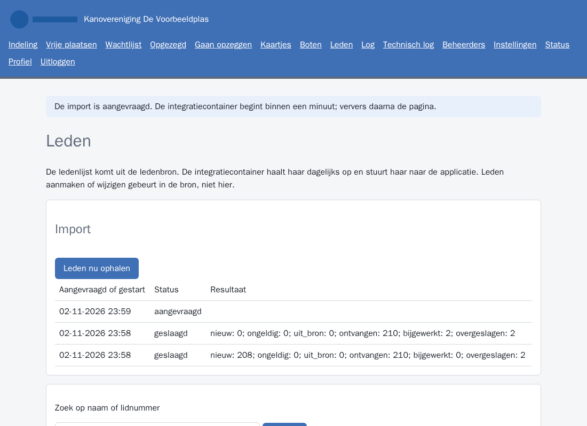

**De uitkomst lezen.** De tabel toont de laatste vijf imports met tijdstip, status en resultaat.

| Status | Betekenis |
|---|---|
| aangevraagd | Het verzoek wacht op de integratiecontainer. |
| geslaagd | De import is verwerkt. Het resultaat telt de leden: ontvangen, nieuw, bijgewerkt, overgeslagen, ongeldig en uit_bron (leden die in de bron ontbraken en oud-lid zijn geworden). |
| mislukt | Het resultaat noemt de reden: de ledenbron is niet bereikbaar, het antwoord is onleesbaar, of de bron weigerde de inloggegevens. De ledenlijst is dan niet gewijzigd. |

Blijft een verzoek op aangevraagd staan, dan draait de integratiecontainer waarschijnlijk niet. Meld dat aan wie de installatie beheert.

## Het mutatielog

Elke wijziging van een beheerder en elke wijziging door een robottoken komt in het log, met tijdstip, wie het deed, de handeling, waarop die betrekking had en een paar gegevens. Het log kan niet worden aangepast. Een wijziging van een lid door de import staat er niet in, een wijziging in de botenadministratie als gevolg daarvan wel.

`/log` toont de nieuwste 50 mutaties. Elk overzicht en elke detailpagina toont de regels die erbij horen, bijvoorbeeld de geschiedenis van één plaats of boot. De handeling heeft de vorm onderwerp.handeling, zoals `plaats.toegewezen` of `boot.aangemaakt`.

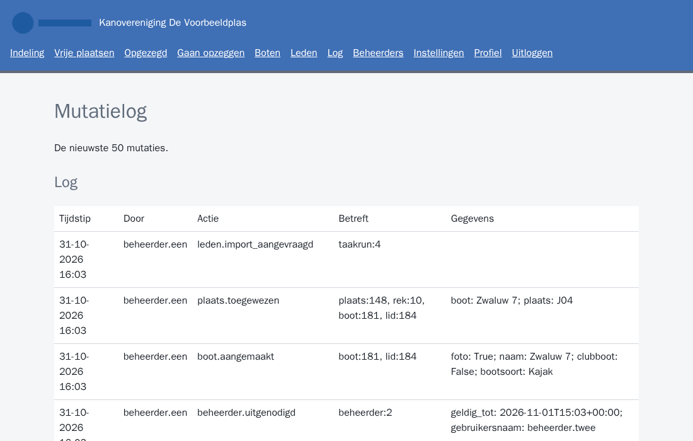

## Naam, kleuren en logo

Op `/instellingen` pas je de naam van de vereniging en twee kleuren aan. Ze staan op elke pagina, ook de openbare. Opslaan vraagt een inlog van hooguit 10 minuten oud. Het logo zet wie de installatie beheert in de installatie; je ziet het hier alleen.

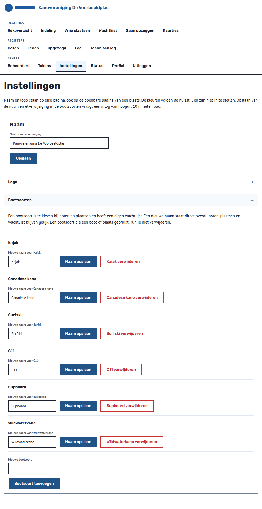

## Alle adressen

Wat tussen accolades staat, vult de applicatie zelf in.

| Adres | Pagina |
|---|---|
| `/` | Startpagina met je eigen laatste mutaties |
| `/inloggen` | Inloggen |
| `/inloggen/code` | Code uit de authenticator-app |
| `/uitnodiging/{code}` | Account instellen met een uitnodigingslink |
| `/profiel` | Je inlogmethodes |
| `/beheerders` | Beheerders uitnodigen en beheren |
| `/indeling` | Rekken en plaatsen |
| `/indeling.xlsx` | Export naar Excel |
| `/plaatsen/{nummer}` | Een plaats, toewijzen en vrijgeven |
| `/boten` | Boten |
| `/boten/{nummer}` | Een boot |
| `/vrij` | Vrije plaatsen |
| `/opgezegd` | Plaatsen van opgezegde leden |
| `/opzeggend` | Boten van leden die gaan opzeggen |
| `/leden` | Leden en de import |
| `/leden/{nummer}` | Een lid |
| `/log` | Mutatielog |
| `/instellingen` | Naam, kleuren en logo |
| `/p/{sleutel}` | Openbare pagina van een plaats |
| `/afbeelding/{sleutel}` | Foto op de pagina van een boot of plaats |
| `/logo/{kenmerk}` | Logo in de kopbalk |
| `/huisstijl.css` | Kleuren van de vereniging |

Ververs de afbeeldingen met `documentatie/gebruikers/schermafbeeldingen.sh` (start een eigen testomgeving en ruimt die op).
